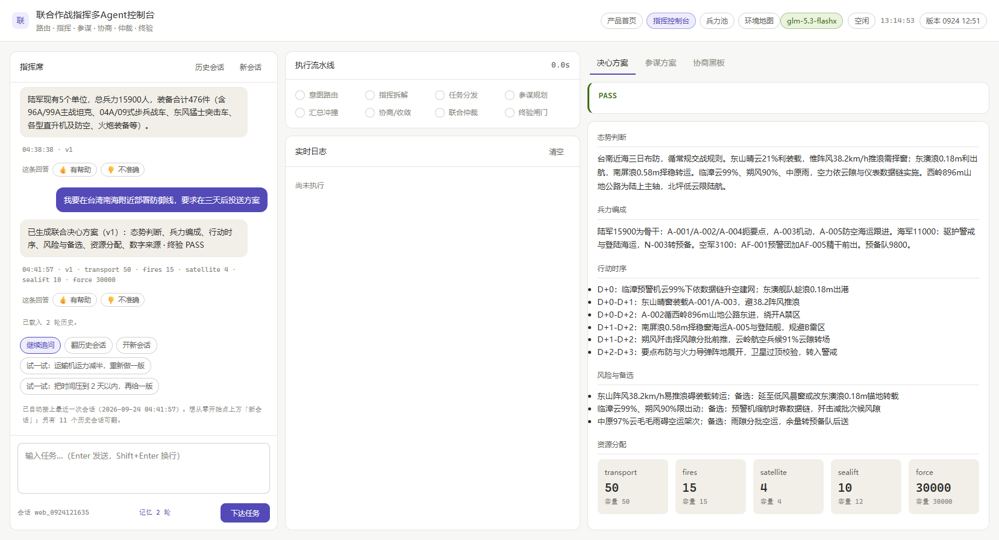
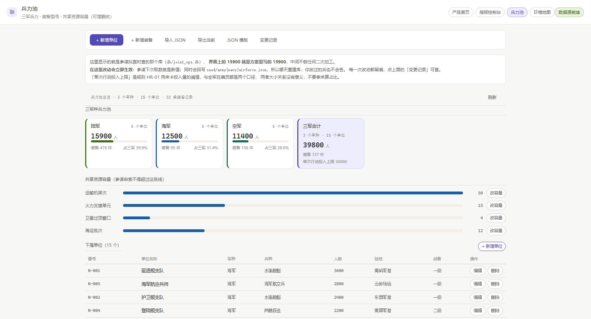
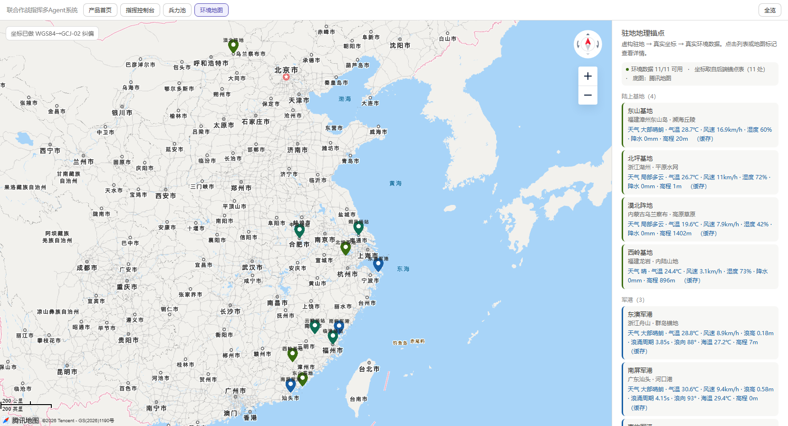
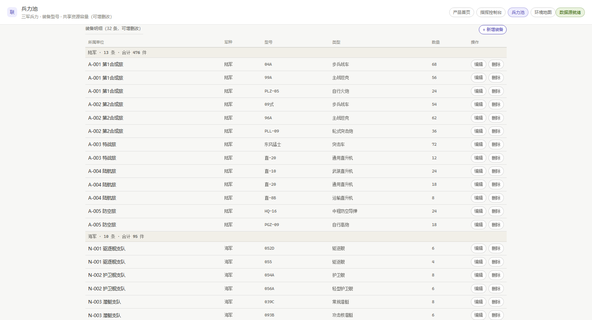

# 联合作战指挥多Agent系统

基于 **LangGraph** 的多智能体联合作战筹划系统：三个军种参谋并行拟案、跨军种协商收敛、指挥员裁决，
配 Web 控制台（兵力池管理 / 作战环境地图 / 多轮会话 / 回答反馈学习）。

> 一句话：你用自然语言下达作战意图，系统自动给出带兵力清单、装备保障、行动方案的完整筹划，
> 你可以追问、调整兵力、点"有用/没用"让它越用越准。

## 在线演示

**直接点开就能用（无需安装、无需 Key）：** https://bfd3b59917a747d9a930947d1de9b8b2.app.workbuddy.host

打开后在对话框输入作战意图（例如"筹划一次跨海登陆行动"），即可体验三军参谋拟案 → 协商 → 裁决的全链路。

## 界面一览

| 指挥控制台 | 兵力池 |
|---|---|
|  |  |

| 作战环境地图 | 装备明细 |
|---|---|
|  |  |

## 它能做什么

- **作战筹划全链路**：意图识别 → 三军参谋并行拟案 → 跨军种协商（分歧自动收敛）→ 指挥员综合裁决
- **兵力池管理**：陆/海/空三军单位的增删改查、装备/资源挂载、JSON 导入导出、变更留痕
- **作战环境地图**：腾讯地图底图 + 单位驻地标注（Key 由服务端注入，前端不暴露）
- **多轮会话**：基于 SQLite checkpoint，关掉浏览器下次接着聊，历史逐轮留痕
- **回答反馈学习**：点"有用/没用"+ 原因，反馈提炼成改进线索注入下一轮提示词
- **数字全部带溯源**：界面上每个数字与参谋取数同源（SQLite 单库），不做前端二次计算
- **诚实性底线**：中途失败的一轮绝不冒充成功（有专门的回归测试守着这条线）

## 快速开始（Windows，不用命令行）

1. 安装 Python 3.10+（勾选 "Add Python to PATH"）
2. 双击 `0_启动产品.bat` —— 它会自动：装依赖 → 建数据库 → 启动服务 → 打开浏览器
3. 按 `接真模型操作指南.md` 配置大模型 Key 后即可提问

## 快速开始（macOS / Linux / 手动）

```bash
python -m pip install -r requirements.txt
python db/build_db.py                     # 从 seed/ 建库
export LLM_API_KEY=sk-xxxxxxxx            # 智谱开放平台的 Key
export LLM_BASE_URL=https://open.bigmodel.cn/api/paas/v4
python server.py --port 8000              # 打开 http://127.0.0.1:8000
```

## 需要的 Key

| Key | 用途 | 必须？ | 申请地址 |
|---|---|---|---|
| `LLM_API_KEY` | 大模型（默认对接智谱 GLM） | **必须** | https://open.bigmodel.cn |
| `TENCENT_MAP_KEY` | 腾讯位置服务（地图底图） | 可选（不配则显示体验版底图） | https://lbs.qq.com |

配置方式：复制 `config/.env.example` 为 `config/.env`，填入 Key（`.env` 已被 gitignore，不会被提交）。

## 项目结构

```
server.py               # FastAPI 服务：SSE 流式、静态页、地图 Key 注入
src/agents/             # LangGraph 图：意图→参谋(Send并行)→协商→裁决
src/tools/              # 兵力池 / 反馈学习 / 失败留痕 等工具
web/                    # 四个页面：首页/指挥控制台/兵力池/作战环境地图
seed/                   # 三军兵力与地理锚点种子数据
db/build_db.py          # 由种子数据建库
tests/                  # 344 项回归断言（run_all.py 一键全跑）
0_启动产品.bat ~ 6_跑全部回归.bat   # Windows 双击入口
```

## 测试

```bash
python tests/run_all.py    # 静态检查 + 13 组测试（约 15 分钟，含真实浏览器点击用例）
```

## 文档

- `接手说明（先看这份）.md` —— 从零接手本项目该看什么
- `产品使用手册.md` —— 面向使用者的操作手册
- `联合作战指挥多Agent系统-设计总纲.md` —— 架构与设计决策
- `联合作战指挥多Agent系统-LangGraph执行层设计.md` —— 执行层细节
- `真模型验收报告.md` / `第四期验收报告.md` —— 验收记录
