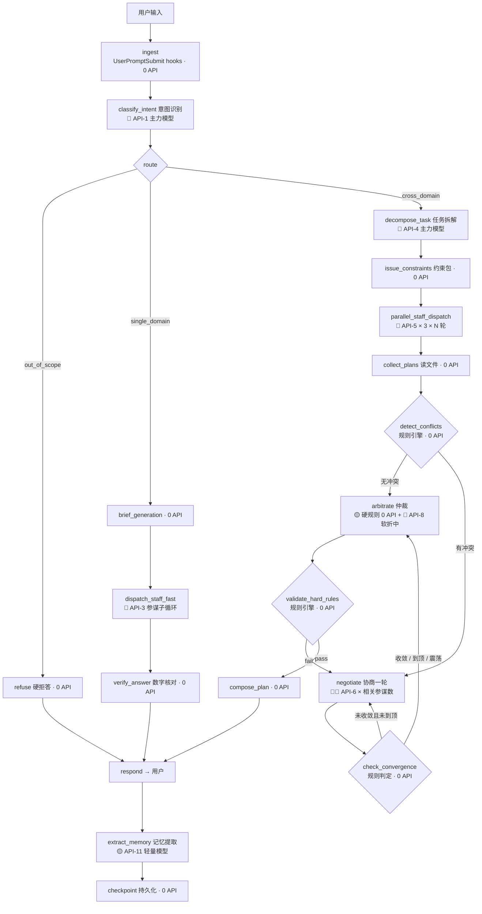

# 联合作战指挥多 Agent 系统 · LangGraph 执行层设计

> 版本：v2.0　｜　日期：2026-09-15　｜　上游文档：`设计总纲 v1.0`
> 参考体系：[Learn Claude Code](https://learn.shareai.run/zh/s01/) s01–s20（从 102 行循环到 1708 行完整 harness 的 20 个渐进机制）

---

## 0. 你说得对：垂直 agent 也必须有图执行层

之前把"垂直"和"执行层"混在一起谈，是一个设计漏洞。现在拆清楚——**它们是正交的两个维度**：

| 维度 | 回答的问题 | 决定者 |
|------|-----------|--------|
| **垂直（领域）** | 这个 agent 会什么、拒什么 | 领域本体 + 任务单 + 边界表 |
| **执行层（harness）** | 这个 agent 怎么跑、怎么恢复、怎么协作 | **节点 / 状态 / 循环 / 检查点** |

s01 开篇就点破了这件事：

> **1729 行的 `query.ts`，核心就是 30 行 `while True`。** 所有复杂字段、退出路径、恢复策略，都是围绕这个循环叠加的保护机制。后面 19 章都在这个循环上叠机制，**循环本身始终不变**。

所以你的系统最终形态是：

```
机制很多，循环一个。
模型负责决策（要不要调工具、调哪个）；harness 负责执行、恢复、协作。
垂直性体现在"给循环喂什么领域工具和领域约束"，而不是"换一个循环"。
```

---

## 1. s01–s20 机制映射总表（每一课落在系统哪个位置）

| 课程 | 机制 | 在联合作战系统中的落点 | 优先级 |
|------|------|------------------------|--------|
| **s01** Agent Loop | `while True` + tool_use 判断 | **所有 agent 的心脏**：意图层/指挥层/参谋层共用同一个循环内核 | ★★★ 必须 |
| **s02** Tool Use | dispatch table 查表分发 | 参谋工具表（查兵力/装备/部署/写方案），加工具 = 加一行映射 | ★★★ 必须 |
| **s03** Permission | 三道闸门 → **四态 PermissionResult** | **越权拦截层**：参谋不得改约束；禁区/兵力上限写进 DENY_LIST | ★★★ 必须 |
| **s04** Hooks | 4 事件（生产级 27 事件） | `PreToolUse` = 硬规则校验；`PostToolUse` = 产物落盘校验；`Stop` = 记忆提取 | ★★★ 必须 |
| **s05** TodoWrite | 计划 + nag 提醒 | 参谋内部规划（先列步骤再拟案）；指挥层的执行清单 | ★★ 重要 |
| **s06** Subagent | 全新 `messages[]` + 只回摘要 | **参谋 spawn 的实现机制**（v1.0 已论证，此处给它一个正式身份） | ★★★ 必须 |
| **s07** Skill | 两级加载（目录常驻 + 内容按需） | **领域知识注入**：作战条令、编成规范、兵种约束，用到才加载 | ★★ 重要 |
| **s08** Context Compact | 四层压缩（便宜的先跑） | 长会话/长推演的上下文管理；**推演类任务必然撞上** | ★★ 重要 |
| **s09** Memory | 四类记忆 + 索引 + 提取/整理 | 用户偏好、领域约束、项目事实、资源位置——**跨会话不丢** | ★★ 重要 |
| **s10** System Prompt | 分段 + 运行时组装 + 缓存 | **参谋的 system prompt 运行时拼装**（身份 + 工具 + 约束 + 技能目录） | ★★ 重要 |
| **s11** Error Recovery | 13 种 reason code + 恢复路径 | API 层韧性：参谋 spawn 失败重试、429/529 退避、max_tokens 升级 | ★★★ 必须 |
| **s12** Task System | 任务 DAG（`blockedBy` + owner + 文件持久化） | **指挥层任务拆解的落地**——"先侦察后机动"就是依赖边 | ★★★ 必须 |
| **s13** Background Tasks | 后台线程 + `<task_notification>` 注入 | **三参谋并行 spawn** 的并发载体；长推演放后台 | ★★★ 必须 |
| **s14** Cron Scheduler | 独立调度线程 + durable job | 例行态势报告、定时推演、每日兵力池校对（可后置） | ★ 可选 |
| **s15** Agent Teams | 文件收件箱（`.jsonl` 邮箱） | **参谋间通信的物理载体**——协商黑板书的底层实现 | ★★ 重要 |
| **s16** Team Protocols | `request_id` 请求-响应握手 | **协商消息契约**、参谋关机协议、方案审批协议 | ★★ 重要 |
| **s17** Autonomous | idle 轮询 + 自动认领 | 参谋从任务板**自动认领**分到的子任务，指挥不逐个派发 | ★ 可选 |
| **s18** Worktree | 目录隔离 + 分支 | **方案版本隔离**：`plans/army.v1/` `v2/` 各自目录，互不覆盖 | ★ 可选 |
| **s19** MCP Tools | `tools/list` + `tools/call` + `mcp__server__tool` | **情报/气象/地图/卫星**的接入协议（v1.0 预留的能力位，此处给协议） | ★★ 重要 |
| **s20** Comprehensive | 机制归位到一个循环 | **最终集成蓝图**——所有机制挂在同一个 `while True` 上 | ★★★ 终点 |

**一句话读表**：s01/s02/s06/s12/s13 是骨架（循环、工具、隔离、任务、并发），s03/s04 是安全（权限、钩子），s08/s09/s10 是记忆与提示（压缩、记忆、组装），s11 是韧性，s15/s16/s17 是协作（邮箱、协议、自治），s19 是外部能力，s20 是合体。

---

## 2. LangGraph 三要素落地：State / Node / Edge

### 2.1 State 定义（完整字段）

LangGraph 的核心是**一个贯穿全程的可变 State**，所有节点读写它。下面是你系统的 State 完整定义（吸收了 s01 的 State 10 字段 + 联合作战域新增）：

```python
from typing import TypedDict, Literal

class JointOpsState(TypedDict):
    # ── 消息与轮次（s01）─────────────────────────────
    messages: list                  # 当前活跃消息数组
    turn_count: int                 # 轮次计数
    max_turns: int                  # 轮次上限（防失控）

    # ── 路由与任务单 ────────────────────────────────
    task_order: dict                # 结构化任务单（领域/类型/复杂度/约束）
    route: Literal["single_domain", "cross_domain", "simulation", "out_of_scope"]

    # ── 约束与资源 ──────────────────────────────────
    constraints: dict               # 全局约束：时间窗/兵力上限/禁区/优先级/ROE
    resource_locks: dict            # 共享资源占用表（运力/火力/卫星窗口）

    # ── 计划与任务（s05 + s12）──────────────────────
    todos: list                     # 当前会话执行清单（内存）
    tasks: dict                     # 任务 DAG：{task_id: {blockedBy, owner, status}}
    current_task: str | None        # 正在执行的任务

    # ── 参谋产物（s06 + s18）────────────────────────
    plans: dict                     # {army: "plans/army.v2.json", ...}
    plan_version: int               # 方案版本号（增量重规划的依据）

    # ── 协商（s15 + s16）────────────────────────────
    negotiation_round: int          # 当前协商轮次（0 = 未进入协商）
    max_negotiation_rounds: int     # 上限（默认 2–3）
    blackboard: list                # 协商记录 [{round, speaker, claim, objection, ask, concession}]
    oscillating: bool               # 震荡标记（让步被收回）

    # ── 上下文管理（s08）────────────────────────────
    context_tokens: int             # 估算 token 数
    compact_count: int              # 已压缩次数
    has_attempted_reactive: bool    # 本轮是否已应急压缩

    # ── 恢复（s11）──────────────────────────────────
    recovery: dict                  # {has_escalated, retry_attempt, consecutive_529, current_model}

    # ── 记忆与技能（s07 + s09）──────────────────────
    memory_index: str               # MEMORY.md 内容（注入 system prompt）
    loaded_skills: list             # 已加载的技能名
    mcp_servers: list               # 已连接的 MCP server 名

    # ── 产物与审计 ─────────────────────────────────
    final_plan: dict | None         # 最终方案
    trace: list                     # 审计日志（每个节点的进出）
```

> **设计要点**：`negotiation_round` 和 `oscillating` 是两个**循环控制字段**——LangGraph 的循环不是 `while True`，而是"条件边回到上一个节点"，这两个字段就是循环的退出条件。`plan_version` 支撑增量重规划：改约束只 `+1` 版本，不重跑全链路。

### 2.2 节点清单（含 API 标注）

| 节点名 | 职责 | 读 State | 写 State | **API** |
|--------|------|----------|----------|---------|
| `ingest` | 接收用户输入，触发 UserPromptSubmit hooks | - | messages, trace | 0 |
| `classify_intent` | 意图识别 → 结构化任务单 | messages | task_order, route | **🔴 LLM 主力** |
| `refuse` | 领域外硬拒答 | route | final_plan | 0 |
| `brief_generation` | 生成自包含简报（快通道） | task_order, constraints | messages | 0（纯模板） |
| `dispatch_staff_fast` | spawn 单个参谋（快通道） | messages | plans | **🔴 LLM × N 轮**（子循环） |
| `verify_answer` | 快通道轻量校验（数字对得上库） | plans | messages | 0 |
| `decompose_task` | 指挥层任务拆解 → 任务 DAG | task_order | tasks | **🔴 LLM 主力** |
| `issue_constraints` | 下发全局约束 + 生成简报包 | constraints, tasks | messages | 0（模板） |
| `parallel_staff_dispatch` | 三参谋并行 spawn（LangGraph `Send`） | messages, constraints | plans | **🔴 LLM × 3 × N 轮** |
| `collect_plans` | 收产物：读文件，不采信摘要 | plans | plans, trace | 0 |
| `detect_conflicts` | 资源冲突检测（规则引擎） | plans, resource_locks | conflicts | **0** |
| `negotiate` | 协商一轮：黑板 + 增量修订 | conflicts, blackboard | blackboard, plans | **🔴🔴 LLM × 相关参谋数** |
| `check_convergence` | 收敛判据（无新 objection / 到顶 / 震荡） | blackboard, negotiation_round | oscillating | **0** |
| `arbitrate` | 仲裁：硬规则过滤 + 软冲突折中 | conflicts, constraints, blackboard | final_plan | **🔴 LLM 主力**（软部分） |
| `validate_hard_rules` | 规则引擎终验 | final_plan, constraints | - | **0** |
| `compose_plan` | 合成最终方案 + 让步记录 | final_plan | final_plan | 0 |
| `respond` | 输出给用户 | final_plan | messages | 0 |
| `extract_memory` | Stop hook：提取记忆 | messages | memory_index | **🟡 LLM 轻量** |
| `checkpoint` | 持久化 State | 全部 | 检查点文件 | 0 |

> **关键观察**：`detect_conflicts` 和 `check_convergence` 是 **0 API** 的纯规则节点。这是刻意设计——**判定类逻辑不交给 LLM**，否则协商循环会烧钱且不可控。

### 2.3 边与条件路由（两个循环）

**主流程（线性 + 三路分支）：**

```
ingest → classify_intent → route
  route == out_of_scope        → refuse → respond → END
  route == single_domain       → brief_generation → dispatch_staff_fast → verify_answer → respond → END
  route == cross_domain        → decompose_task → issue_constraints
```

**全链路（含协商循环）：**

```
issue_constraints → parallel_staff_dispatch → collect_plans → detect_conflicts
  detect_conflicts == no_conflict    → arbitrate
  detect_conflicts == conflict       → negotiate
negotiate → check_convergence
  check_convergence == converged     → arbitrate
  check_convergence == not_converged 且 round < max → negotiate   ← 循环 ①
  check_convergence == oscillating 或 round == max → arbitrate    ← 强制退出
arbitrate → validate_hard_rules
  validate_hard_rules == fail        → negotiate（带新争议点）      ← 循环 ②
  validate_hard_rules == pass        → compose_plan → respond → END
```

**LangGraph 代码骨架：**

```python
from langgraph.graph import StateGraph, END
from langgraph.types import Send

def route_after_intent(state: JointOpsState) -> str:
    return state["route"]          # "single_domain" | "cross_domain" | "out_of_scope" | "simulation"

def route_after_conflict(state: JointOpsState) -> str:
    if not state["conflicts"]:
        return "arbitrate"
    return "negotiate"

def route_after_convergence(state: JointOpsState) -> str:
    if state["oscillating"]:
        return "arbitrate"                                   # 震荡 → 强制裁决
    if state["negotiation_round"] >= state["max_negotiation_rounds"]:
        return "arbitrate"                                   # 到顶 → 强制裁决
    if not has_new_objection(state["blackboard"]):
        return "arbitrate"                                   # 收敛 → 裁决
    return "negotiate"                                       # ← 循环回边

def dispatch_staffs(state: JointOpsState):                   # 并行分发（s13 + LangGraph Send）
    return [Send("staff_subgraph", {"domain": d, "brief": b})
            for d, b in zip(["army", "navy", "air"], build_briefs(state))]

g = StateGraph(JointOpsState)
g.add_node("ingest", ingest)
g.add_node("classify_intent", classify_intent)               # 🔴 API
g.add_node("decompose_task", decompose_task)                 # 🔴 API
g.add_node("parallel_staff_dispatch", parallel_staff_dispatch)
g.add_node("detect_conflicts", detect_conflicts)             # 0 API，纯规则
g.add_node("negotiate", negotiate)                           # 🔴 API
g.add_node("check_convergence", check_convergence)           # 0 API，纯规则
g.add_node("arbitrate", arbitrate)                           # 🔴 API
g.add_node("validate_hard_rules", validate_hard_rules)       # 0 API
g.add_node("compose_plan", compose_plan)
g.add_node("respond", respond)

g.set_entry_point("ingest")
g.add_edge("ingest", "classify_intent")
g.add_conditional_edges("classify_intent", route_after_intent,
                        {"out_of_scope": "refuse", "single_domain": "brief_generation",
                         "cross_domain": "decompose_task"})
g.add_edge("decompose_task", "issue_constraints")
g.add_edge("issue_constraints", "parallel_staff_dispatch")
g.add_edge("parallel_staff_dispatch", "collect_plans")
g.add_edge("collect_plans", "detect_conflicts")
g.add_conditional_edges("detect_conflicts", route_after_conflict,
                        {"arbitrate": "arbitrate", "negotiate": "negotiate"})
g.add_conditional_edges("negotiate", route_after_convergence,
                        {"arbitrate": "arbitrate", "negotiate": "negotiate"})
g.add_conditional_edges("arbitrate", lambda s: "fail" if s.get("hard_fail") else "pass",
                        {"fail": "negotiate", "pass": "compose_plan"})
g.add_edge("compose_plan", "respond")
g.add_edge("respond", END)
```

### 2.4 参谋子图（subgraph）

每个参谋是一个 **LangGraph subgraph**，拥有**独立的 State 和独立的 checkpointer**——这就是 s06"上下文隔离"在图层面的表达：

```
staff_subgraph（陆军/海军/空军共用，参数化 domain）
  ingest_brief（读简报，0 API）
  → plan_steps（todo_write，s05，🔴 API）
  → query_resources（查 SQLite 兵力池，0 API，纯工具）
  → draft_plan（拟案，🔴 API，内部 while True 循环）
  → hard_rule_check（约束校验，0 API）
     fail → draft_plan（自纠，内部循环）
     pass → write_plan（落盘 plans/{domain}.json，0 API）
  → summarize（≤200 字摘要，🔴 API 轻量）
  → 返回主图
```

**参谋的退出条件**（对应 s06 的"30 轮安全限制"）：`max_turns = 30`，超限强制返回 `error_code: MAX_TURNS`，触发主图 s11 恢复路径。

### 2.5 Checkpoint 持久化（多轮对话的真正载体）

LangGraph 的 `checkpointer` 就是 v1.0 说的"多轮会话状态外置"的正式实现：

```python
from langgraph.checkpoint.sqlite import SqliteSaver
checkpointer = SqliteSaver.from_conn_string("joint_ops_state.db")

app = g.compile(checkpointer=checkpointer)
# 多轮对话：同一 thread_id 的 State 自动恢复
app.invoke({"messages": [...]}, config={"configurable": {"thread_id": session_id}})
```

**落到 SQLite 的表**：

| 表 | 存什么 | 对应 v1.0 的哪条 |
|----|--------|------------------|
| `checkpoints` | 每个节点执行后的 State 快照 | 多轮会话状态 |
| `tasks` | 任务 DAG（s12 的 `.tasks/*.json` 改为表） | 任务图 |
| `negotiation_round` | 协商黑板 | 协商记录 |
| `memory` | 四类记忆（s09） | 用户偏好 / 领域约束 / 项目事实 / 资源位置 |
| `plans` | 参谋方案版本（s18 用目录隔离，此处用版本字段） | 方案版本 |

### 2.6 LangGraph 原语对照表

| LangGraph 原语 | 在本系统中的对应 | 来源课程 |
|----------------|------------------|----------|
| `StateGraph` + `State` | `JointOpsState` | s01 State 10 字段 |
| `add_node` | 18 个节点（§2.2） | s01–s20 各机制 |
| `add_conditional_edges` | 四态路由 + 冲突分支 + 收敛分支 | s01 退出路径 |
| **`Send` API** | **三参谋并行分发（map-reduce）** | s13 Background |
| **`subgraph`** | **参谋子图（上下文隔离）** | s06 Subagent |
| **`interrupt()`** | **人工审批**（禁区操作、方案审批） | s03 Permission ask 闸门 |
| **`checkpointer`** | **多轮会话状态 + 跨会话恢复** | s09 Memory + s08 Compact |
| `retry` / fallback | s11 恢复路径 | s11 Error Recovery |
| `Command(resume=...)` | 人审后继续执行 | s03 ask → allow/deny |

---

## 3. 端到端执行图（Mermaid，含 API 标注）



---

## 4. API 调用点全景标注（本设计的核心交付）

### 4.1 调用点清单

| 编号 | 调用点 | 所在节点 | 模型档位 | 单次调用次数 | 成本级别 | 能否省略 |
|------|--------|----------|----------|--------------|----------|----------|
| **API-1** | 意图识别 + 任务单结构化 | `classify_intent` | 🔴 主力模型 | 1 | 低 | 否（入口必需） |
| **API-2** | 指挥层任务拆解 | `decompose_task` | 🔴 主力模型 | 1 | 低-中 | 跨域任务必需 |
| **API-3** | 快通道参谋子循环 | `dispatch_staff_fast` | 🔴 主力模型 | N（通常 2–5 轮） | 低-中 | 否 |
| **API-4** | 全链路参谋并行 spawn | `parallel_staff_dispatch` | 🔴 主力模型 | **3 × N（每个参谋独立循环）** | **中-高** | 否 |
| **API-5** | 协商每轮增量修订 | `negotiate` | 🔴 主力模型 | **相关参谋数 × 轮数** | **🔴🔴 最高** | 有冲突时必需 |
| **API-6** | 仲裁（软冲突折中） | `arbitrate` | 🔴 主力模型 | 1 | 中 | 无冲突可跳过 |
| **API-7** | 压缩摘要（`compact_history`） | `compact` 前处理 | 🔴 主力模型 | 触发时 1 | 中 | 长会话必需 |
| **API-8** | 记忆选取 side-query | `load_memories` | 🟡 轻量模型（haiku 档） | 每轮开始 1 | 极低 | 可降级为关键词匹配 |
| **API-9** | 记忆提取 | `extract_memory`（Stop hook） | 🟡 轻量模型 | 每轮结束 1 | 极低 | 可选 |
| **API-10** | 记忆整理（Dream） | `consolidate_memories` | 🟡 轻量模型 | 文件数 ≥10 时 1 | 极低 | 可选 |
| **API-11** | 权限自动审批分类器 | `PreToolUse` hook | 🟡 轻量模型 | 危险操作时 1 | 低 | 可选（退回人审） |
| **API-12** | 工具使用摘要 | 后台 side-query | 🟡 轻量模型 | 每批工具后 1 | 极低 | 可选（UI 用） |
| **API-13** | MCP 工具调用 | 参谋工具执行 | **非 LLM** | 按需 | 视服务 | 领域必需 |
| **API-14** | prompt cache | API 基础设施层 | - | - | **省钱** | 强烈建议开启 |

### 4.2 成本热点：协商子循环是唯一的 🔴🔴

这是整个系统**唯一可能成本爆炸**的地方，必须用三个闸门锁死：

| 闸门 | 机制 | 上限 |
|------|------|------|
| **轮次闸门** | `max_negotiation_rounds = 3` | 最多 3 轮，超顶强制仲裁 |
| **参与闸门** | 只拉冲突相关参谋（通常 2 个，不是 3 个） | 最多 2 次 LLM 调用/轮 |
| **震荡闸门** | 版本 diff 检测让步收回 → 立即退出 | 防无限横跳 |

**最坏情况成本**：`1（意图）+ 1（拆解）+ 3×5（三参谋）+ 2×3（两参谋协商 3 轮）+ 1（仲裁）+ 1（压缩）≈ 24 次主力模型调用`。
**最好情况**（单域查询）：`1（意图）+ 3（单参谋）≈ 4 次`。

> **省钱原则**：`detect_conflicts`、`check_convergence`、`validate_hard_rules` 三个判定节点**永远 0 API**。判定交给规则引擎，LLM 只负责生成和折中。

### 4.3 API 基础设施层（s11 的完整移植）

| 机制 | 触发 | 动作 | 参数 |
|------|------|------|------|
| **429 限流** | RateLimitError | 指数退避 + 抖动 | `min(500×2^attempt, 32000) + random(0~25%)`，最多 10 次 |
| **529 过载** | OverloadedError | 退避；连续 3 次切 fallback model | `MAX_529_RETRIES = 3` |
| **max_tokens 截断** | `stop_reason == "max_tokens"` | 第一次升 8K→64K 重试；仍截断则保存输出 + 注入续写提示，最多 3 次 | `ESCALATED_MAX_TOKENS = 64000` |
| **prompt too long** | 413 | reactive compact → 重试 1 次；再失败抛异常 | `MAX_REACTIVE_RETRIES = 1` |
| **MCP 连接断开** | ECONNRESET 等 | 连续 3 次 → 关闭 + 重连 | 指数退避 |
| **MCP 401** | 令牌过期 | 触发重认证 | - |
| **参谋 spawn 失败** | 子图超限/异常 | 返回 `error_code` + 落盘路径，主图决定重试或降级 | `max_turns = 30` |

> **重要**：`with_retry` 包住的是**每一次 `client.messages.create`**。这意味着 API-1 到 API-12 的每个调用点都自动获得这层保护——这是 s11 的价值：写一次，处处生效。

---

## 5. 工具表（联合作战域的 dispatch table）

### 5.1 参谋工具（三个参谋共用，domain 参数化）

| 工具名 | 功能 | 权限 | 是否落盘 |
|--------|------|------|----------|
| `query_force_pool` | 查兵力（SQL 聚合，**数字唯一来源**） | readOnly | 否 |
| `query_equipment` | 查装备型号/数量 | readOnly | 否 |
| `query_deployment` | 查驻地/海域/空域 | readOnly | 否 |
| `query_resource_window` | 查共享资源可用窗口（运力/卫星） | readOnly | 否 |
| `write_plan` | 写方案到 `plans/{domain}.v{n}.json` | write | **是** |
| `load_skill` | 加载作战条令/编成规范（s07） | readOnly | 否 |
| `send_message` | 协商发消息到黑板/对方邮箱（s15/s16） | - | 是 |
| `read_file` / `bash`（受限） | 读上下文/跑计算 | 受 s03 闸门 | 视操作 |

### 5.2 指挥层工具

| 工具名 | 功能 | 对应课程 |
|--------|------|----------|
| `decompose_task` | 目标 → 任务 DAG | s12 |
| `create_task` / `claim_task` / `complete_task` | 任务 CRUD + 依赖解锁 | s12 |
| `issue_constraints` | 生成全局约束包 | - |
| `dispatch_staff` | spawn 参谋（`Send` API） | s06 + s13 |
| `request_negotiation` | 开启协商子循环 | s15/s16 |
| `arbitrate` | 触发仲裁 | - |
| `compose_final_plan` | 合成最终方案 | - |

### 5.3 系统层工具

| 工具名 | 功能 | 对应课程 |
|--------|------|----------|
| `todo_write` | 会话内计划 + nag 提醒 | s05 |
| `compact` | 主动触发压缩 | s08 |
| `memory_write` / `memory_load` | 记忆读写 | s09 |
| `connect_mcp` | 连接外部服务，工具池动态扩容 | s19 |
| `checkpoint_save` / `checkpoint_load` | State 快照/恢复 | LangGraph |

## 5A. 与 s20 执行流程的闭环对照（2026-09-15 深夜增补）

> 缘起：对照 s20 的"执行流程图"（User Input → Assemble Context → Policy+Hooks → LLM Call → Route Tool → 四路工具 → Append Result → Recover/Compact → 回环）后发现：两图**形态不同但层次互补**，且 s20 的闭环照出了本设计图上的 **2 个真实缺口**。

### 5A.1 为什么长得不一样：一个是"引擎"，一个是"赛道路网"

| 维度 | s20 执行流程 | 本系统 LangGraph 图 |
|------|-------------|-------------------|
| 本质 | **单 agent 通用引擎**：一个 LLM 在 while 循环里反复"调工具→结果追加→再想"，直到它自己决定 done | **多 agent 编排路网**：图形状本身编码了军事方法论（路由→指挥→参谋→仲裁） |
| 循环粒度 | **每次工具调用一圈**（细粒度）：工具结果 Append 后立刻回到上下文重组 | **按阶段一圈**（粗粒度）：只在协商轮之间回环；三参谋并行分支不共享循环 |
| "done" 由谁判 | LLM 自己（Route Tool 菱形判断） | 规则引擎（收敛判据/硬规则终验），LLM 无权自行终止 |
| 反馈闭环 | Recover/Compact：错误恢复 + 上下文压缩 → 回到上下文重组 | 多轮会话状态（checkpointer）：下一轮用户输入携带槽位+方案版本回来 |
| 工具分支 | 四路（Built-in / Teams / Background / Worktree-MCP） | 参谋域内工具（SQL/MCP），由参谋子图内部消化 |

**两者不冲突，是两层关系**：本系统的**每个节点内部**（参谋拟案、指挥拆解）就应该是一台 s20 式引擎——"组装上下文→LLM→查工具→追加结果→恢复/压缩"的小循环；LangGraph 图负责节点之间的**赛道路网**。s20 教的是"怎么造发动机"，我们的图定义的是"整辆车怎么跑"。

### 5A.2 对照后发现的 2 个真实缺口（需要补强）

**缺口 1：节点级失败恢复回路缺失。** s20 的 Recover/Compact 是闭环的一部分——任何工具失败/上下文爆掉都回到循环而非崩溃。我们的图里，错误恢复只做到了 **API 调用层**（§4.3 `with_retry` 处理 429/529），**图层面没有任何失败回路**：参谋 spawn 失败、校验失败直接崩穿整次会话。实测脚本里 `validate` 用 assert 也证明了这点——assert 失败=整个 invoke 抛异常。
**补强方案（v2.2 已升级为"分层回退 + 归因分派"）**：State 增加 `retry_count` / `failure_type` / `escalate_to` 字段；`validate` 失败不 assert，先做**失败归因（0 API 规则判定）**，再按归属层回退——**回退目标由归因决定，不是一律回指挥层**：
- **方案求解失败**（超限/违规，约束本身没问题）→ 回 `commander` 重新下发约束（重解析意图无济于事，可用运力不会变大）；
- **产物格式残缺**（缺章节/数字无来源）→ 回 `arbitrate` **局部修复**（不重跑参谋，省成本）；
- **任务单约束自相矛盾**（指挥层无解）→ 回 `intent` 并**升级为用户澄清**（`interrupt` 语义，输出 `NEED_USER_CLARIFICATION` + 问题文本），**不做硬重试**——否则会陷入"重解析→同样失败"的无效循环，且 LLM 每次重解析任务单会漂移，越跑越偏且不可追溯。
每层 `retry_count ≤ 2` 封顶，仍失败则输出结构化失败报告；参谋 spawn 失败由 dispatch 捕获，降级为"其余军种规划 + 标注信息缺口"。

**缺口 2：最终输出缺少完整性闸门。** s20 的输出是"LLM 判 done → Final Output"，而我们的 `validate` 只验硬规则（兵力上限/时间窗/禁区），**不验产物完整性**——方案缺时序表、缺风险章节也能流出去。
**补强方案**：`validate` 节点内增加产物 schema 校验（输出契约 C 系列的机器可查子集：必填章节、每条行动必须有资源来源引用、数字必须能对回 SQL 查询结果），不完整则同样走缺口 1 的回环，失败原因写明"缺哪个章节"。

### 5A.3 结论

- **结构性优化：不需要推倒**。图的骨架（四态路由/双链路/协商循环/中心仲裁）与 s20 不矛盾，二者是编排层与引擎层的关系。
- **需要补 2 条边**：`validate → commander`（失败恢复回环，带 retry_count 封顶）+ `validate` 内部产物完整性校验。**已实做并实测通过**（2026-09-15 深夜，langgraph_skeleton_test.py v2.1，故障注入用例 T7–T10 全 PASS：恢复回环生效、完整性闸门拦截、封顶降级输出、参谋失败降级）。§2.3 的"两个循环"更新为"**四个循环**"（协商回环、参谋自纠、失败恢复回环、多轮会话闭环）。


> **s02 的核心纪律在这里生效**：加一个工具 = 在 `TOOLS` 数组加一条 + 在 `TOOL_HANDLERS` 字典加一行，**循环代码一行不改**。

---

## 6. 分阶段开发路线图（s01 → s20 映射到本系统）

按课程节奏推进，每一步都是一个可运行的最小闭环：

| 阶段 | 做什么 | 对应课程 | 验收标准 |
|------|--------|----------|----------|
| **M1 循环内核** | 单 agent + 兵力池查询工具 | s01 + s02 | "陆军多少人"能答对，数字来自 SQL |
| **M2 安全层** | 硬规则 + 越权拦截 | s03 + s04 | 参谋试图改约束 → 被打回 |
| **M3 隔离与并行** | 参谋子图 + `Send` 并行 | s06 + s13 | 三参谋并行出初案，互不污染 |
| **M4 任务图** | 指挥层拆解 + 依赖解锁 | s12 | "先侦察后机动"自动排序 |
| **M5 冲突与仲裁** | 规则引擎 + 中心化裁决 | - | 运力冲突能被检测并裁决 |
| **M6 协商子循环** | 黑板 + 增量修订 + 收敛判据 | s15 + s16 | 2 轮内收敛，震荡能被拦截 |
| **M7 记忆与压缩** | 多轮对话 + 长推演不崩 | s08 + s09 | 30 轮后仍记得用户约束 |
| **M8 韧性** | 错误恢复 + 重试 + 降级 | s11 | 断网/限流/截断都能自动恢复 |
| **M9 外部能力** | MCP 接入气象/地图 | s19 | 参谋能查到天气影响 |
| **M10 集成** | 一个循环装下所有机制 | s20 | 端到端跑通全链路 |

**建议从 M1 开始，不要跳。** s01 的教训是：循环内核不稳，后面 19 层全是空中楼阁。

---

## 7. 待决事项更新（v1.0 的 4 项 + 新增 2 项）

| # | 待决问题 | 备选项 | 建议 |
|---|----------|--------|------|
| 1 | 第一步交付形态 | 可运行骨架 / 设计蓝图 / 骨架+真实模型 / Demo | **M1 可运行骨架**（模型先 Mock） |
| 2 | 单域查询链路 | 快通道直连 / 过指挥层 / 全链路 | **快通道直连** |
| 3 | 仲裁机制 | 硬规则+模型折中 / 纯模型 / 多轮协商 | **硬规则优先 + 模型折中 + 冲突触发协商** |
| 4 | 兵力池粒度 | 单位级 / 聚合数字 / 含战备部署 | **单位级** |
| **5**（新） | **是否直接用 LangGraph 框架，还是手写 harness** | 用框架（`StateGraph`/`Send`/`interrupt`/`checkpointer` 开箱即用） / 手写（完全掌控，参照 s20 自己搭） | **用 LangGraph**——s20 的结论是"机制很多，循环一个"，LangGraph 把循环、并行、检查点、人审这些**已经造好的轮子**给你，你只需要写节点函数和领域工具 |
| **6**（新） | **LLM 提供方与模型档位** | 单一主力模型 / 主力+轻量双档 | **双档**：主力做生成与折中，轻量做记忆选取/提取/分类器（省 80% 的辅助调用成本） |

---

## 附：与 v1.0 设计总纲的关系

| v1.0（领域设计） | v2.0（执行层设计） |
|------------------|---------------------|
| 回答"这个 agent 是什么、会什么、拒什么" | 回答"这个 agent 怎么跑、怎么恢复、怎么协作" |
| 三段式控制流（意图→指挥→仲裁） | 同样的控制流，但落成 **State + 节点 + 条件边** |
| 快通道 / 全链路 | 同样的链路，但用 `route` 字段 + 条件边实现 |
| 兵力池 JSON→SQLite | 不变，新增 `checkpoints` / `negotiation_round` / `memory` 表 |
| MCP 预留 | s19 协议落地（`mcp__server__tool` 命名 + 工具池动态组装） |
| 协商黑板 | s15 文件收件箱 + s16 `request_id` 握手落地 |

**两份文档合起来才是完整设计**：v1.0 是"领域骨架"，v2.0 是"运行时血肉"。
