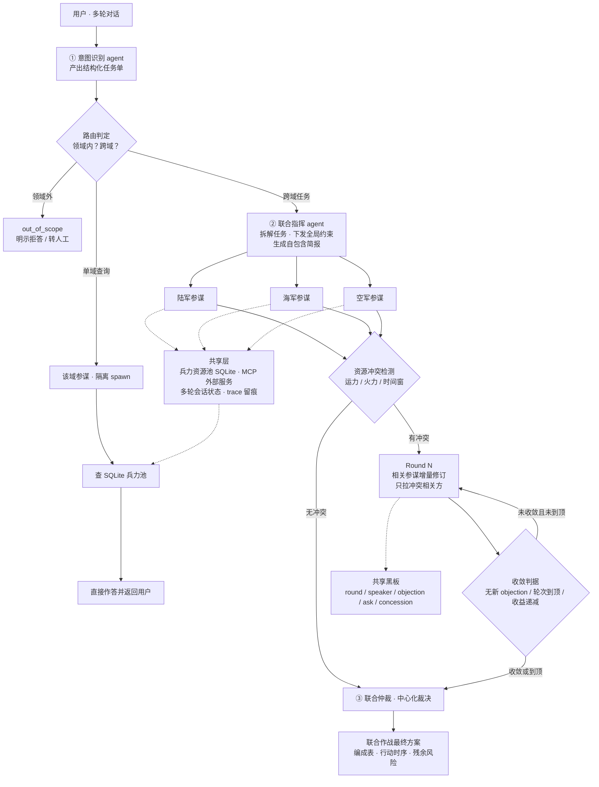

# 联合作战指挥多 Agent 系统 · 设计总纲

> 版本：v1.0　｜　日期：2026-09-15　｜　状态：**设计对齐完成，尚未开发**
> 来源：需求讨论全过程的完整沉淀，含架构决策、被否决的方案及其理由、待决事项。

---

## 0. 一句话定义

**这不是"多个 agent 一起聊天"，而是一个 `路由 → 编排 → 仲裁` 的三段式控制流系统。**
难点不在对话，在于**什么时候只叫一个人、什么时候叫所有人，以及叫完之后谁说了算**。

---

## 1. 系统定位：它是一个垂直 Agent

### 1.1 先纠正一个混淆

**"垂直"讲的是领域宽度，不是 agent 数量。** 这与"单 agent / 多 agent"是完全正交的两个维度：

| | 单 Agent | 多 Agent |
|---|---|---|
| **通用领域** | 通用聊天助手 | 通用多角色协作 |
| **垂直领域** | 领域专家助手 | **← 本项目（联合作战筹划）** |

所以：**垂直 ≠ 单 agent，垂直 ≠ 单轮对话。**

### 1.2 垂直性落在五个地方

| # | 收敛层 | 具体内容 |
|---|--------|----------|
| ① | **入口纪律** | 唯一入口，**领域外请求硬拒答**，不顺手代答 |
| ② | **领域本体** | 兵力 · 编成 · 装备 · 作战筹划词表是唯一真源 |
| ③ | **专属工具** | 兵力池 SQL · 领域 MCP；**不挂通用搜索** |
| ④ | **固定方法论** | 意图 → 指挥 → 参谋 → 仲裁，流程写死 |
| ⑤ | **输出契约** | 兵力编成表 · 行动时序 · 风险与备选，非自由文本 |

> **判断标准：垂直 agent 的标志不是「它会什么」，而是「它能不能明确拒绝什么」。**
> 如果它能顺手把"帮我写个周报"也答了，那它就只是个通用 agent 加了一层提示词。

### 1.3 垂直的代价与收益

| 付 出 | 换 回 |
|-------|-------|
| 领域数据得自己养（兵力池自建） | 约束可写死，越权可拦截 |
| 领域本体得人来定 | 数字可追溯，不靠模型心算 |
| 边界外**完全没有能力** | 方案可评估、可复盘 |
| 泛化能力为零 | 上下文小、成本低、幻觉低 |

**结论：这笔账在本场景是划算的——作战筹划本来就不允许模型自由发挥。**

### 1.4 垂直深度阶梯（本项目目标为 L3 → L4）

```
L1  知识问答        ── 查资料、给定义
L2  带工具查询      ── 会调库取数          ← 快通道落在这里
L3  带流程规划      ── 固定方法论产出方案   ← 全链路主干
L4  带约束与仲裁的决策支持  ── 冲突可裁决、让步可追溯  ← 协商子循环 + 仲裁
```

---

## 2. 总体架构：三段式控制流

### 2.1 三大核心 Agent

| 编号 | 角色 | 职责 | 关键产出 |
|------|------|------|----------|
| **①** | **意图识别 Agent**（总入口） | 意图分类、任务单结构化、路由决策 | **结构化任务单** |
| **②** | **联合指挥 Agent** | 任务拆解、依赖排序、**下发全局约束** | 自包含简报 + 约束包 |
| **③** | **联合仲裁** | 资源冲突裁决、折中重规划、一致性校验 | 联合作战最终方案 |

### 2.2 结构化任务单（路由读的是它，不是模型的直觉）

| 字段 | 取值 |
|------|------|
| `domain` | 陆 / 海 / 空 / 联合 |
| `task_type` | 查询 / 规划 / 推演 / 对比 |
| `complexity` | 单域 / 跨域耦合 |
| `constraints` | 时间窗 · 兵力上限 · 禁区 · 优先级 · 交战规则（槽位） |
| `resolved_refs` | 指代消解结果（"它""那个方向"指向什么） |
| `route` | **四态**：`single_domain` / `cross_domain` / `simulation` / `out_of_scope` |

### 2.3 双链路：按需编排，不是固定流水线

| | **快通道**（单域查询） | **全链路**（跨域任务） |
|---|---|---|
| 触发 | "陆军现在多少人、多少装备" | 复杂作战背景、需要联合筹划 |
| 经过 | 意图层 → **该域参谋** → 查库 → 作答 | 意图 → 指挥 → 三参谋 → 协商? → 仲裁 |
| 是否过指挥层 | 否 | 是 |
| 是否过仲裁 | 否（仅轻量校验） | 是 |
| 设计理由 | 查个数字不该让三位参谋各发一遍言 | 跨域资源争抢必须有人裁 |

### 2.4 全局约束由指挥层下发（参谋不得越权）

参谋**只能在约束内求解，不能自己改条件**。这既对应真实的"指令—计划"关系，也是仲裁能生效的前提。

- 可下发的全局约束：时间窗、兵力上限、禁区、优先级、交战规则
- 拦截点：参谋提交的方案先过**规则引擎硬校验**，越界直接打回

---

## 3. 数据层设计

### 3.1 兵力资源池（先做最简陋版）

三份 JSON 作**权威种子**，灌进 SQLite：

```
army.json / navy.json / airforce.json
        ↓  (一次性导入脚本)
SQLite：units 表 + equipment 表 + aggregate 视图
```

单条记录的最小形态：

```json
{
  "id": "A-001",
  "单位": "第X合成旅",
  "军种": "陆军",
  "人员": 4200,
  "主要装备": [
    { "型号": "99A",    "数量": 56 },
    { "型号": "PLZ-05", "数量": 24 }
  ],
  "驻地": "XX",
  "战备状态": "一级"
}
```

**粒度建议：单位级**（营/旅、舰艇、中队 + 主战装备型号数量 + 驻地）。够支撑规划，不搞战备率和坐标。

### 3.2 硬原则：数字必须来自 SQL

> **所有数字必须由参谋 agent 调工具查 SQLite 返回，禁止模型心算或编造。**
> JSON 只是种子，参谋手里只有查询工具。

这是"陆军现在多少人"这类问题不翻车的**唯一**办法。

### 3.3 MCP 外部服务

作为**可插拔能力位**接入，现在可空着。预留接口：

- 情报 · 气象 · 地形地图 · 卫星过顶窗口 · 仿真推演

### 3.4 多轮会话状态（必须外置）

| 存储内容 | 说明 |
|----------|------|
| 意图槽位 | 已确认的时间窗、兵力上限、禁区等 |
| 已下发约束 | 指挥层对本次任务下发的全局约束快照 |
| 方案版本 | `v1` / `v2` … 每次重规划的产物 |
| 协商记录 | 黑板表（见 §5） |

> **多轮对话存的是"槽位 + 方案版本"，不是聊天记录。**
> 用户改一个条件（如"登陆时间提前两小时"）→ **增量重规划**：只让受影响的参谋重算，仲裁做增量校验，而不是整条链路从头重跑。

---

## 4. 执行模型：子 Agent 的隔离机制

### 4.1 机制语义

调用 task 工具时：**spawn 一个子 Agent，拥有全新 `messages[]`，跑自己的循环，结束后只把摘要文本回传给主 Agent。对话上下文被丢弃，但文件系统的副作用（写文件、改文件、跑命令）保留在工作目录中。**

**这不是"函数调用"，是"进程级隔离的派遣"——更像 `fork` 而不是 `call`。**

### 4.2 四条语义 → 四个架构后果

| 语义 | 架构后果 |
|------|----------|
| `messages[]` 全新 | **调用 prompt 必须完全自包含**：任务单 + 全局约束 + 资源快照 + 输出 schema + 落盘路径，全塞进去 |
| 只回传摘要文本 | **摘要是有损压缩**，只能当索引。产物以落盘为准，指挥与仲裁**只读文件里的数字** |
| 上下文丢弃 | 多轮记忆**必须外置**。同一会话二次调用陆军参谋，它完全不记得上次给过什么 |
| 文件副作用保留 | 文件系统是三个参谋之间**唯一的横向通道**，也是实现并行的前提 |

### 4.3 两条通信通道

```
        ┌────────────── 主 Agent（持有完整 messages[] 与多轮槽位）──────────────┐
        │                                                                      │
   ┌────┴─────┐  灰实线 spawn                      橙虚线 只回传摘要            │
   ↓          ↑                                        ↑                       │
┌────────┐ ┌────────┐ ┌────────┐                                                   
│陆军参谋│ │海军参谋│ │空军参谋│   ← messages[] 全新，互不可见，可真并行           
└───┬────┘ └───┬────┘ └───┬────┘                                                   
    │蓝实线落盘 │          │                                                        
    ↓          ↓          ↓                                                        
工作目录：plans/army.json · plans/navy.json · plans/air.json · trace/*.log        
```

### 4.4 对主 Agent 角色定义的修正（重要）

> 主 Agent 不再是"调度器"，而是 **上下文持有者 + 简报生成器 + 文件仲裁者** 三合一。
> 它自己几乎不产生"知识"，全部知识都来自它读回来的文件。

### 4.5 领域语义对照

这套机制在组织和语义上**就是"任务式命令"（Auftragstaktik）的技术等价物**：
上级只给**意图、约束、可用资源、回报格式**，不给执行步骤；下级自主决定怎么做；回报只给结论不汇报过程。

---

## 5. 协商机制（在隔离之上新增的一层）

### 5.1 结论先行

**可以做到子 agent 之间协商**——隔离不是"子 agent"的固有属性，是**"每次调用都新开无状态子进程"这个用法**的属性。换掉用法，路就开了。

核心思路只有一个：**把"一次性的派遣"改成"有记忆的协商"。**

### 5.2 三种实现方案对比

| | 方案 1：常驻会话 | 方案 2：常驻主持人 + 版本化产物 | 方案 3：群聊单会话 |
|---|---|---|---|
| **做法** | 参谋做成持有各自 `messages[]` 的**常驻对象**，跨轮只 append | 参谋仍无状态 spawn，**主持人常驻**持有协商史；方案落盘 `v1/v2`，下轮让它读自己的 v1 当外部记忆 | 放弃子 agent，改**一条共享 `messages[]` + 角色标签**，speaker 轮转 |
| **协商保真度** | 高（参谋记得自己的论证） | 中（记忆靠文件模拟，易反复横跳） | 最高（真正的开会） |
| **成本** | **O(n)**，只传增量 | O(n) 但每轮重放切片 | **O(n²)**，上下文线性膨胀 |
| **并行能力** | 中 | 高 | 无 |
| **主要风险** | 有状态 → 生命周期管理复杂、崩溃恢复难 | 推理连贯性差、主持人 prompt 膨胀、需版本 diff 防震荡 | **群体谄媚**、专业专注度稀释、调试难 |
| **适用** | 长期协商 | 需要强隔离与可重试 | 冲突轮次**短时**开启 |

### 5.3 推荐：混合式 —— "默认裁决，冲突才升级为协商"

> 军事上本来就是这么干的：平时各军种独立拟案，**争资源的时候才开联席会**，联席会开不成由指挥员裁定。
> 不会一上来就让三个军种坐一桌吵。

```
常态：三参谋隔离并行出初案（成本低、专注度高、可并行）
  ↓
冲突检测：对共享资源（运力 / 火力 / 时间窗）做结构化比对
  ↓
有冲突 → 开「协商子循环」：只拉冲突相关的参谋（通常 2 个）
         带明确议程：争议资源 · 各自诉求 · 约束上限
  ↓
最多 2–3 轮：收敛 → 记录让步；不收敛 → 仲裁按优先级强制裁决
```

### 5.4 落地必须钉死的五件事（少一件就翻车）

1. **收敛判据要机器可判**：无新增 `objection` ／ 轮次到顶 ／ 边际收益低于阈值。三者取或，否则死循环。
2. **防震荡**：每轮做版本 diff；若新一轮把上一轮的让步又拿回去 → 标记 `oscillating`，**直接强制裁决**。
3. **协商记录必须落盘**：用户事后问"为什么这么定"，要能翻出第 2 轮陆军提了什么反建议、空军让了什么。
4. **参与者裁剪**：空军没参与就不会来抢运力，别把三个都拉进来陪跑。
5. **硬约束每轮即时校验**：规则引擎在每次修订后立刻跑，否则参谋会"谈出一个违规方案"，还得回头拆。

### 5.5 协商黑板书（SQLite 表 `negotiation_round`）

| 字段 | 含义 |
|------|------|
| `round` | 第几轮 |
| `speaker` | 发言人（army / navy / air） |
| `claim` | 本方主张 |
| `objection` | 对他人主张的反对点 |
| `resource_ask` | 索取的共享资源 |
| `concession` | 本轮做出的让步（防震荡的依据） |

---

## 6. 仲裁机制

### 6.1 采用：中心化裁决（硬规则优先 + 模型折中）

| 层次 | 处理对象 | 手段 |
|------|----------|------|
| **硬约束层** | 兵力上限、时间窗、禁区 | **规则引擎强制过滤**，越界直接打回，无商量余地 |
| **软冲突层** | 共享资源的额度分配 | 指挥/仲裁 agent 依据优先级做一次性折中 |
| **兜底层** | 协商不收敛 / 检测到震荡 | 按优先级**强制裁决**，并记录残余风险 |

### 6.2 被否决的方案及原因

| 方案 | 结论 | 原因 |
|------|------|------|
| **纯模型裁决** | 不采用 | 灵活但不可控，硬约束会被"权衡"掉 |
| **多轮协商收敛**（全程） | 不采用 | 成本失控；仅在**冲突发生时**以子循环形式开启（见 §5.3） |
| **参谋互提反建议直连** | **不可实现** | 子 agent 互相隔离、互不可见，只能由指挥居中转达 |

---

## 7. 关键契约清单

> 以下七条是硬约定，写代码前必须先固化。

| # | 契约 | 说明 |
|---|------|------|
| **C1** | **简报自包含** | 调用 prompt 必须含：任务单 + 全局约束 + 资源快照 + 输出 schema + 落盘路径。子 agent 看不到任何历史 |
| **C2** | **产物落盘为准** | 参谋输出 = 写完整 JSON（主） + 回传 ≤200 字摘要（辅）。摘要只是索引 |
| **C3** | **数字只信文件** | 指挥与仲裁**不采信摘要文本中的任何数字**，一律读文件 |
| **C4** | **状态外置** | 多轮槽位、约束、方案版本一律存共享层，不寄望于子 agent 记住 |
| **C5** | **失败结构化** | 子 agent 失败也必须返回 `error_code` + 落盘路径，否则主 agent 拿不到任何线索 |
| **C6** | **过程留痕** | 子 agent 自行写 `trace/*.log`，否则失败时无从复盘 |
| **C7** | **防震荡** | 每轮版本 diff，让步被拿回即标记 `oscillating` 并强制裁决 |

---

## 8. 决策记录

### 8.1 已拍板（2026-09-15 全部关闭）

| # | 待决问题 | 结论 | 备注 |
|---|----------|------|------|
| 1 | 第一步交付形态 | **可运行骨架**（已实做） | `langgraph_skeleton_test.py` 实测 T1–T6 全 PASS |
| 2 | 单域查询链路 | **快通道直连** | 实测验证：单域查询只出 1 份参谋报告，跳过指挥与仲裁 |
| 3 | 仲裁机制 | **硬规则优先 + 模型折中 + 冲突触发协商子循环** | 中心化仲裁；协商仅拉冲突方，≤3 轮封顶 |
| 4 | 兵力池粒度 | **单位级** | 营/旅/舰/中队 + 装备型号数量 + 驻地 |
| 5 | 执行框架 | **LangGraph** | Send 并行 / 条件边回环 / checkpointer 复用现成原语 |
| 6 | 模型档位 | **主力+轻量双档** | 辅助调用（意图分类/查库改写/记忆选取/压缩）走轻量档，省约 80% 辅助成本 |
| 7 | 数据检索路线 | **明确放弃 RAG 向量化** | 参谋只通过结构化查询（SQL/API）读兵力池；字段结构设计优先于存储介质选型 |
| 8 | 服务对象 | **方法论验证 + 工程规格双职能** | 设计文档需同时承担两者 |
| 9 | 成功标准 | **三类典型链路跑通且行为符合设计** | 拒答 / 快通道 / 全链路协商；T1–T6 升格为验收用例 |
| 10 | v1 范围 | **完整版**（最小闭环+协商循环+MCP+完整多轮） | 按分期路径交付：M1 循环内核+兵力池 → M2 协商 → M3 多轮+MCP |

### 8.2 业务定义定稿（一句话）

> 本项目是一个**联合作战筹划垂直 agent**：入口路由管分流，联合指挥管拆解与仲裁，三军参谋管领域规划和数据查询；把自然语言的作战问题可靠地转成**有全局约束、数字可追溯、冲突可仲裁**的结构化决策支持；底层是三个可演进的兵力资源池（JSON 起步 → SQLite 落地），明确不走 RAG 向量化路线。

### 8.3 仍待办（非架构决策，属编写/实现任务）

1. **领域边界表**：哪类问题进、哪类拒、哪类转人工。
2. **通信契约规范**：简报模板、产物 schema、摘要格式、失败回传格式。
3. **协商最小闭环**：黑板表结构 + 收敛判据 + 一轮协商的增量消息模板。

---

## 9. 端到端流程图



**读图要点：**

- 琥珀色 `out_of_scope` 分支是**垂直 agent 的纪律出口**，必须有，不能省。
- 快通道**跳过指挥与仲裁**，这是"按需编排"而非固定流水线。
- 协商子循环是**条件触发**的增量层，不是主流程的一部分。
- 底部共享层是所有 agent 的**唯一数据来源**，虚线代表"工具调用"。

---

## 10. 术语表

| 术语 | 含义 |
|------|------|
| **快通道** | 单域事实查询链路，意图层直连该域参谋，跳过指挥与仲裁 |
| **全链路** | 跨域任务的完整链路：意图 → 指挥 → 参谋 → （协商）→ 仲裁 |
| **简报** | 调用子 agent 时传入的完全自包含 prompt（任务式命令） |
| **黑板** | 协商轮次的共享记录表，参谋之间唯一的横向通道载体 |
| **收敛判据** | 判定协商可以停止的机器可判条件 |
| **震荡 / oscillating** | 新一轮把上一轮让步收回的状态，触发强制裁决 |
| **out_of_scope** | 领域外出口，明示拒答而非顺手代答 |
| **任务式命令** | Auftragstaktik：只给意图、约束、资源、回报格式，不给步骤 |

---

## 附：架构演进轨迹（本方案的来由）

| 轮次 | 议题 | 关键产出 |
|------|------|----------|
| 1 | 需求复述 | 三段式控制流 + 双链路 + 数据层分层 |
| 2 | "垂直 agent" 辨析 | 五层收敛 + `out_of_scope` 第四态出口 |
| 3 | 子 agent 隔离机制 | 两条通道 + 主 agent 角色重定义 + **否决直连协商** |
| 4 | 如何恢复协商 | 三方案对比 + **混合式（冲突触发升级）** + 五个必钉事项 |
| 5 | 沉淀 | 本文档 + 端到端流程图 |
