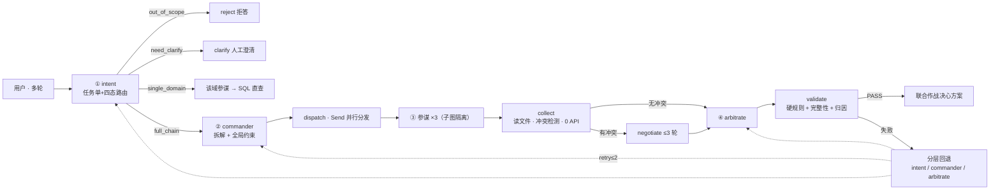

# 联合作战指挥多 Agent 系统 · 项目设计文档

| 项 | 内容 |
|---|---|
| 版本 | **v2.0（设计定稿）** |
| 日期 | 2026-09-16 |
| 状态 | **设计完成 · 控制流已验证（Mock）· 产品实现未开始** |
| 文档职能 | 双职能：**设计决策链**（给评审看"为什么这么定"）+ **工程规格**（给开发看"怎么建"） |
| 配套文档 | 《设计总纲》（领域细节）·《LangGraph 执行层设计》（运行时细节）·《节点状态图 v2》《端到端流程图》· `langgraph_skeleton_test.py`（验收脚本） |

**变更记录**

| 版本 | 日期 | 变更 |
|---|---|---|
| v1.0 | 2026-09-16 上午 | 首次起草（7 章，结论与规格） |
| **v2.0** | 2026-09-16 | 纳入：① 失败恢复升级为**分层回退 + 归因分派**（实测 T11/T12）；② s20 闭环对照的 2 项补强落地；③ 补 **领域边界表** 与 **工程结构**；④ 验收用例扩至 **T1–T12**；⑤ 决策记录收口为 10 项已关闭 |

> 阅读约定：本文只写**结论与规格**。推导过程、方案对比、被否决理由的完整论证见两份专题文档，本文不重复。

---

## 1. 业务定义与边界

### 1.1 一句话定义

> 一个**联合作战筹划垂直 agent**——把自然语言的作战问题，可靠地转成**有全局约束、数字可追溯、冲突可仲裁**的结构化决策支持。
>
> 入口路由管分流，联合指挥管拆解与仲裁，三军参谋管领域规划与数据查询；底层是三个可演进的兵力资源池（JSON 起步 → SQLite 落地）。**核心玩法是"总指挥 + 三军参谋"的角色分工，不是一个大模型包打天下。**

### 1.2 领域边界表（进 / 拒 / 转人工）

| 类别 | 典型输入 | `route` | 处理 |
|---|---|---|---|
| 单域事实查询 | "陆军现在多少人、多少装备" | `single_domain` | **快通道**：该域参谋查 SQL 直接作答 |
| 跨域筹划 | "某方向登陆作战背景，陆海空联合行动规划" | `full_chain` | **全链路**：指挥拆解 → 三参谋并行 → 冲突检测 →（协商）→ 仲裁 |
| 域内推演 / 对比 | "运力减半，登陆方案怎么调整" | `full_chain` | 全链路 + **版本化增量重规划**（复用既有方案版本） |
| **约束矛盾 / 需求不清** | "3 天内投送 8 万人，运力只用 10 架次" | `need_clarify` | **转人工澄清**：输出 `NEED_USER_CLARIFICATION` + 具体问题 |
| **领域外通用任务** | "帮我写周报""翻译这段""查天气" | `out_of_scope` | **明示拒答**，不顺手代答 |
| **实战指挥 / 真实情报** | "直接下达开火命令""敌方真实部署在哪" | `out_of_scope` | 拒答并说明：仅提供**筹划层面**支持、仅基于模拟/演习数据 |
| **高阶审批操作** | 涉及禁区、超权限兵力调动 | — | `interrupt()` 挂起，等人工审批后 `Command(resume)` |

### 1.3 四角色编制

| 角色 | 职责 | 关键产出 |
|---|---|---|
| **入口路由 Agent** | 意图识别 → 产出**结构化任务单** → 决定链路 | 结构化任务单 |
| **联合指挥 Agent** | 任务拆解、依赖排序、**下发全局约束**、失败恢复重下发 | 自包含简报 + 约束包 |
| **海 / 陆 / 空参谋 ×3** | 域内专业规划 + 兵力装备数据查询入口 | `plans/{domain}.v{n}.json` + ≤200 字摘要 |
| **联合仲裁**（指挥层职能） | 资源冲突裁决、折中重规划、一致性校验 | 联合作战决心方案 |

### 1.4 三条链路

| 链路 | 触发 | 走向 | 特点 |
|---|---|---|---|
| **快通道** | 单域事实问询 | 路由 → 该域参谋 → 查 SQLite → 直接作答 | 跳过指挥与仲裁，省 token |
| **全链路** | 复杂作战背景 | 路由 → 指挥拆解+约束 → 三参谋并行 → 冲突检测 →（必要时协商）→ 仲裁 → 终验 → 决心方案 | 完整筹划 |
| **拒答 / 澄清** | 领域外 / 约束矛盾 | 路由 → 明示拒答 / 转人工澄清 | 垂直 agent 的标志出口 |

### 1.5 结构化任务单（路由读的是它，不是模型的直觉）

| 字段 | 取值 |
|---|---|
| `domain` | 陆 / 海 / 空 / 联合 |
| `task_type` | 查询 / 规划 / 推演 / 对比 |
| `complexity` | 单域 / 跨域耦合 |
| `constraints` | 时间窗 · 兵力上限 · 禁区 · 优先级 · 交战规则（ROE） |
| `resolved_refs` | 指代消解结果（"它""那个方向"指向什么） |
| `route` | **四态**：`single_domain` / `full_chain` / `out_of_scope` / `need_clarify` |

### 1.6 垂直性的五层收敛

| # | 收敛层 | 具体内容 |
|---|---|---|
| ① | 入口纪律 | 唯一入口，**领域外硬拒答**，不顺手代答 |
| ② | 领域本体 | 兵力 · 编成 · 装备 · 作战筹划词表是唯一真源 |
| ③ | 专属工具 | 兵力池 SQL · 领域 MCP；**不挂通用搜索** |
| ④ | 固定方法论 | 意图 → 指挥 → 参谋 → 仲裁，流程写死 |
| ⑤ | 输出契约 | 编成表 · 行动时序 · 风险与备选，非自由文本 |

> **判断标准：垂直 agent 的标志不是"它会什么"，而是"它能不能明确拒绝什么"。**

**垂直深度阶梯**：L1 知识问答 → L2 带工具查询（快通道）→ L3 带流程规划（全链路主干）→ **L4 带约束与仲裁的决策支持（本项目目标）**。

### 1.7 明确不做

实战指挥 · 真实情报接入 · 领域外任务 · 通用助手 · **RAG 向量化**（参谋只走结构化查询，字段结构设计优先于存储介质选型）。

---

## 2. 总体架构

### 2.1 端到端架构



### 2.2 设计决策链（本文核心）

| 决策 | 结论 | 核心理由 | 被否决方案 |
|---|---|---|---|
| 垂直度 | 领域收窄 + 内部多 agent（两维正交） | 垂直讲领域宽度，不讲 agent 数量 | 单 agent 加提示词 |
| 执行框架 | **LangGraph** | `Send`/`interrupt`/`checkpointer` 是造好的轮子 | 手写 harness（可控但重复造轮） |
| 进入方式 | 子 agent **隔离 spawn + 简报自包含** | 参谋可并行、可重试、崩溃干净 | 群聊单会话（上下文爆炸、群体谄媚） |
| 协商形态 | **默认裁决，冲突才升级为协商** | 军事上本就"平时独立拟案，争资源才开联席会" | 全程多轮协商（成本高、易震荡） |
| 终止判定 | **规则引擎判**，LLM 无权自行终止 | 成本与可控性双保险 | LLM 自判 done |
| 失败恢复 | **分层回退 + 归因分派**（不一律回指挥层） | 回退目标应由失败归属层决定 | 一律 assert 崩溃 / 一律回 intent |
| 模型档位 | **主力 + 轻量双档** | 辅助调用走轻量档，省约 80% 辅助成本 | 单一主力模型 |
| 数字来源 | **必须来自 SQL** | "陆军多少人"不翻车的唯一办法 | LLM 心算 / 从摘要取数 |
| 知识检索 | **结构化查询，放弃 RAG** | 兵力数据是强结构化的，向量化引入不可控 | 向量库 + 语义召回 |

### 2.3 全局约束由指挥层下发（参谋不得越权）

- **可下发约束**：时间窗 · 兵力上限 · 禁区 · 优先级 · 交战规则
- **拦截点**：参谋提交的方案先过**规则引擎硬校验**，越界直接打回
- 参谋**只能在约束内求解，不能自己改条件**——既对应真实"指令—计划"关系，也是仲裁能生效的前提

---

## 3. 数据设计

### 3.1 兵力资源池（JSON 种子 → SQLite 落地）

```
seed/army.json · navy.json · airforce.json   ← 权威种子（相当于 3 个 Excel）
        ↓ 一次性导入脚本
db/joint_ops.db ： units 表 + equipment 表 + aggregate 视图
```

单条记录最小形态（**粒度：单位级**——营/旅、舰艇、中队 + 主战装备型号数量 + 驻地）：

```json
{
  "id": "A-001",
  "单位": "第X合成旅",
  "军种": "陆军",
  "人员": 4200,
  "主要装备": [
    { "型号": "99A",    "数量": 56 },
    { "型号": "PLZ-05", "数量": 24 }
  ],
  "驻地": "XX",
  "战备状态": "一级"
}
```

### 3.2 存储清单

| 存储 | 内容 | 形态 |
|---|---|---|
| 兵力资源池 ×3 | 单位级编成 + 装备型号数量 + 驻地 | SQLite（`units` / `equipment` / `aggregate`），参谋经查询工具读取，后续可 MCP 化 |
| 会话状态 | 多轮槽位、已下发约束、方案版本 | `checkpoints`（LangGraph `SqliteSaver`），**外置于共享层** |
| 协商黑板 | `round / speaker / claim / objection / resource_ask / concession` | SQLite 表 `negotiation_round`，只增 |
| 任务图 | `{task_id: {blockedBy, owner, status}}` | SQLite 表 `tasks` |
| 记忆 | 用户偏好 / 领域约束 / 项目事实 / 资源位置 | SQLite 表 `memory` |
| 参谋产物 | `plans/{domain}.v{n}.json` | 文件系统（版本化目录） |
| 过程留痕 | 每次参谋调用与失败 | `trace/*.log` |

### 3.3 三条硬原则

1. **数字只来自 SQL** —— 所有数字由参谋调工具查库返回，禁止模型心算或编造；JSON 只是种子。
2. **产物以落盘文件为准，摘要只是索引** —— 指挥与仲裁不采信摘要中的任何数字。
3. **字段结构设计优先于存储介质选型** —— 数据残缺或维度太粗时，参谋会陷入"信息不足、约束不清"，这比用什么介质更致命。

### 3.4 MCP 外部能力位（可插拔，v1 可空置）

预留接口：**情报 · 气象 · 地形地图 · 卫星过顶窗口 · 仿真推演**。命名与调用协议依 s19（`mcp__server__tool`）。

---

## 4. 执行层设计

### 4.1 四个循环

| # | 循环 | 触发 | 退出 |
|---|---|---|---|
| ① | **协商回环** | 检测到共享资源冲突 | 无新 objection / 轮次封顶 ≤3 / 震荡 → 强制裁决 |
| ② | **参谋自纠** | 参谋子图内硬约束校验失败 | 校验通过 或 `max_turns=30` 超限（返回 `MAX_TURNS`） |
| ③ | **分层回退**（失败恢复） | `validate` 失败并完成归因 | 恢复成功 或 `retry_count > 2` 降级输出 |
| ④ | **多轮会话闭环** | 下一轮用户输入（同一 `thread_id`） | `checkpointer` 恢复 State + 槽位 |

> 垂直 ≠ 单轮。多轮存的是**"槽位 + 方案版本"**，不是聊天记录：用户说"登陆时间提前两小时" → **增量重规划**（改约束 → 只让受影响参谋重算 → 增量校验），不从头重跑。

### 4.2 State 关键字段

```python
class JointOpsState(TypedDict, total=False):
    # 消息与任务单
    user_input: str
    task_order: dict
    route: str                    # single_domain | full_chain | out_of_scope | need_clarify
    # 参谋产物（add-reducer）
    staff_reports: Annotated[list, add]
    current_asks: list
    conflicts: list
    # 协商（循环控制字段）
    negotiation_round: int
    blackboard: Annotated[list, add]
    # 失败恢复与降级（分层回退）
    retry_count: int              # 每层封顶 2
    validation_failed: bool
    failure_reason: list
    failure_type: str             # plan_violation | artifact_incomplete | constraint_conflict
    escalate_to: str              # commander | arbitrate | intent
    clarify_question: str
    info_gap: list
    # 产物
    final_asks: list
    final_plan: dict
```

> **两个易踩的坑（实测踩过）**：① 未在 State 中声明的字段会被 LangGraph **静默丢弃**（`clarify_question` 曾输出 `null`）；② `staff_reports` 用 add-reducer 时**只增不减**，恢复重跑会累积重复报告导致申请翻倍，须用 `latest_by_domain` 取每域最新版本。

### 4.3 节点清单与 API 档位

| 节点 | 职责 | API 档位 | 实现状态 |
|---|---|---|---|
| `intent` | 意图分类 → 任务单 → 四态路由 | 🟡 轻量（可升主力） | ✅ 已验证 |
| `reject` | `out_of_scope` 硬拒答 | 0 | ✅ |
| `clarify` | 人工澄清出口（`interrupt` 语义） | 0 | ✅ |
| `commander` | 拆解 + 全局约束下发 + 失败恢复重下发 | 🔴 主力 | ✅ |
| `dispatch` | `Send` 并行分发 + **参与者裁剪** | 0 | ✅ |
| `staff` ×3 | 查库（轻量）+ 域内拟案（主力）→ 落盘 + 摘要 | 🟡+🔴 | ✅（Mock） |
| `collect` | 读文件产物 · 冲突检测 · 快通道旁路 · 失败降级 | **0（规则引擎）** | ✅ |
| `negotiate` | 协商一轮，仅拉冲突方，增量修订 | 🔴 主力（成本热点） | ✅（封顶验证） |
| `check_convergence` | 收敛判据（无新 objection / 到顶 / 震荡） | **0** | ✅（并入条件边） |
| `arbitrate` | 硬规则过滤 + 软冲突一次性折中 | 🔴 主力 | ✅ |
| `validate` | 硬规则 + **完整性闸门** + **失败归因** | **0** | ✅ |
| `decompose_task` / `issue_constraints` | 任务 DAG / 约束包（当前合并进 `commander`） | 🔴 / 0 | 🟡 部分 |
| `verify_answer` | 快通道数字对库核对（当前由 `collect` 旁路替代） | 0 | ⚪ 待实现 |
| `compose_plan` / `respond` | 合成最终方案 + 让步记录 / 输出 | 0 | ⚪ |
| `extract_memory` / `checkpoint` | 记忆提取（Stop hook）/ State 持久化 | 🟡 / 0 | ⚪ |
| MCP 工具节点 | s19 外部能力接入 | 非 LLM | ⚪ |

> **省钱原则**：`collect`（冲突检测）、`check_convergence`（收敛判据）、`validate`（硬规则+完整性+归因）**三个判定环节永远 0 API**——判定交给规则引擎，LLM 只负责生成与折中。

### 4.4 边与路由

```
START → intent
  out_of_scope  → reject  → END
  need_clarify  → clarify → END
  single_domain → dispatch → staff(1) → collect → validate → END     ← 快通道旁路仲裁
  full_chain    → commander → dispatch → staff(3) → collect
                    ├ 无冲突 → arbitrate → validate → END
                    └ 有冲突 → negotiate ⇄ check_convergence
                                  └ 收敛/到顶/震荡 → arbitrate → validate → END
validate
  ├ PASS              → END（输出决心方案）
  ├ 失败且 retry ≤ 2  → escalate_to 决定回退层：intent / commander / arbitrate
  └ 失败且 retry > 2  → FAILED_VALIDATION_DEGRADED 结构化降级输出
```

**关键实现细节（实测踩坑）**：分发必须是**独立 `dispatch` 节点**。参谋节点若同时挂"条件分发边"和"出边"会**无限自旋**（自己给自己派活）。

### 4.5 分层回退 + 归因分派（失败回退目标由归因决定）

失败**不是一律回指挥层，更不是一律回意图层**——先做归因（0 API 规则判定），再由归属层决定回退目标：

| 失败类型 | 判据示例 | 回退层 | 理由 |
|---|---|---|---|
| **方案求解失败** | 超兵力上限 / 违反时间窗 / 触禁区 | **`commander`** 重新下发约束 | 任务单没错、约束没错，重解析意图不会让可用运力变大 |
| **产物格式残缺** | 缺"风险"章节 / 数字对不回 SQL | **`arbitrate`** 局部修复 | 与意图/约束无关，**重跑参谋纯属浪费** |
| **任务单约束自相矛盾** | "8 万人 / 10 架次"（指挥层无解） | **`intent` + 升级用户澄清** | 硬重试会陷入无效循环，且 LLM 重解析会**意图漂移**、不可追溯 |

- 每层 `retry_count ≤ 2` 封顶，仍失败 → 输出结构化失败报告（**不崩溃**）
- 单参谋 spawn 失败 → 降级为**其余军种规划 + 方案标注"信息缺口"**（`APPROVED_DEGRADED`），不整盘崩

### 4.6 参谋子图（上下文隔离的图层面表达）

```
staff_subgraph（参数化 domain：army / navy / airforce）
  读简报(0) → plan_steps(todo,🔴) → query_resources(SQL,0)
  → draft_plan(🔴, 内部 while 循环) → hard_rule_check(0)
        fail → draft_plan（自纠）
        pass → write_plan 落盘 plans/{domain}.v{n}.json(0)
  → summarize(🟡 ≤200 字) → 返回主图
```
退出条件：`max_turns = 30`，超限返回 `error_code: MAX_TURNS`，触发主图恢复路径。

### 4.7 API 调用点全景（14 个）

| 编号 | 调用点 | 节点 | 档位 | 次数 | 成本 | 可否省略 |
|---|---|---|---|---|---|---|
| **API-1** | 意图识别 → 任务单 | `intent` | 🟡 轻量（可升主力） | 1 | 低 | 否 |
| **API-2** | 指挥拆解 + 约束下发 | `commander` | 🔴 主力 | 1 | 低-中 | 跨域必需 |
| **API-3** | 参谋查库改写 | `staff.query` | 🟡 轻量 | 每参谋 1 | 极低 | 否 |
| **API-4** | 参谋拟案 | `staff.draft` | 🔴 主力 | N（≤30 轮） | 中-高 | 否 |
| **API-5** | 协商增量修订 | `negotiate` | 🔴 主力 | **相关参谋数 × 轮数** | **🔴🔴 最高** | 有冲突时必需 |
| **API-6** | 仲裁软冲突折中 | `arbitrate` | 🔴 主力 | 1 | 中 | 无冲突可跳过 |
| **API-7** | 上下文压缩 | `compact` | 🔴 主力 | 触发时 1 | 中 | 长会话必需 |
| **API-8** | 记忆选取 side-query | `load_memories` | 🟡 轻量 | 每轮 1 | 极低 | 可降级关键词匹配 |
| **API-9** | 记忆提取 | `extract_memory` | 🟡 轻量 | 每轮 1 | 极低 | 可选 |
| **API-10** | 记忆整理（Dream） | `consolidate` | 🟡 轻量 | 文件 ≥10 时 1 | 极低 | 可选 |
| **API-11** | 权限审批分类器 | `PreToolUse` hook | 🟡 轻量 | 危险操作时 1 | 低 | 可退回人审 |
| **API-12** | 工具使用摘要 | 后台 side-query | 🟡 轻量 | 每批工具后 1 | 极低 | 可选 |
| **API-13** | MCP 工具调用 | 参谋工具执行 | **非 LLM** | 按需 | 视服务 | 领域必需 |
| **API-14** | prompt cache | 基础设施层 | — | — | **省钱** | 强烈建议开启 |

**成本闸门（协商子循环是唯一 🔴🔴 热点）**

| 闸门 | 机制 | 上限 |
|---|---|---|
| 轮次闸门 | `max_negotiation_rounds` | 3 轮，超顶强制裁决 |
| 参与闸门 | 只拉冲突相关参谋（通常 2 个，不是 3 个） | ≤2 次主力调用/轮 |
| 震荡闸门 | 版本 diff 检测让步收回 → 立即退出 | 防无限横跳 |

- **最坏情况**：1 + 1 + 3×5 + 2×3 + 1 + 1 ≈ **24 次主力调用**
- **最好情况**（单域查询）：1 + 3 ≈ **4 次**

> **档位说明**：API-1 原设计为主力档（任务单结构化依赖领域本体判断），骨架实测按轻量档计数以省成本。**M1 先按轻量档跑，若误判率偏高再升主力档**——这是需要实测数据拍板的调优点之一。

### 4.8 API 基础设施韧性（s11 移植，写一次处处生效）

| 机制 | 触发 | 动作 | 参数 |
|---|---|---|---|
| 429 限流 | RateLimitError | 指数退避 + 抖动 | `min(500×2^n, 32000) + random(0~25%)`，≤10 次 |
| 529 过载 | OverloadedError | 退避；连续 3 次切 fallback model | `MAX_529_RETRIES = 3` |
| max_tokens 截断 | `stop_reason == "max_tokens"` | 首次 8K→64K 重试；仍截断则存输出 + 续写提示 | `ESCALATED_MAX_TOKENS = 64000`，≤3 次 |
| prompt too long | 413 | reactive compact → 重试 1 次 | `MAX_REACTIVE_RETRIES = 1` |
| MCP 断连 / 401 | ECONNRESET / 令牌过期 | 退避重连 / 重认证 | 连续 3 次触发 |
| 参谋 spawn 失败 | 子图超限或异常 | 返回 `error_code` + 落盘路径 → 主图重试或降级 | `max_turns = 30` |

> `with_retry` 包住**每一次 `client.messages.create`** → API-1 ~ API-12 全部自动获得保护。

### 4.9 s01–s20 机制映射（Learn Claude Code → 本系统）

| 课程 | 机制 | 落点 | 优先级 |
|---|---|---|---|
| s01 Agent Loop | `while True` + tool_use | 所有 agent 的循环心脏 | ★★★ |
| s02 Tool Use | dispatch table | 参谋工具表，加工具=加一行映射 | ★★★ |
| s03 Permission | 四态 PermissionResult | **越权拦截层**：参谋不得改约束 | ★★★ |
| s04 Hooks | PreToolUse / PostToolUse / Stop | 硬规则校验 · 产物落盘校验 · 记忆提取 | ★★★ |
| s05 TodoWrite | 计划 + nag | 参谋内部规划、指挥执行清单 | ★★ |
| s06 Subagent | 全新 messages + 只回摘要 | **参谋 spawn 的实现机制** | ★★★ |
| s07 Skill | 两级加载 | 领域知识注入（条令/编成规范，按需） | ★★ |
| s08 Context Compact | 四层压缩 | 长会话/长推演上下文管理 | ★★ |
| s09 Memory | 四类记忆 | 跨会话用户偏好与领域约束 | ★★ |
| s10 System Prompt | 运行时组装 | 参谋 system prompt 拼装（身份+工具+约束+技能目录） | ★★ |
| s11 Error Recovery | 13 种 reason code | API 层韧性（§4.8） | ★★★ |
| s12 Task System | 任务 DAG `blockedBy` | **指挥层拆解落地**（"先侦察后机动"= 依赖边） | ★★★ |
| s13 Background Tasks | 后台 + 通知注入 | **三参谋并行 spawn 的并发载体** | ★★★ |
| s14 Cron | 独立调度线程 | 例行态势报告、每日兵力池校对 | ★ 可选（暂缓） |
| s15 Agent Teams | 文件收件箱 `.jsonl` | **协商黑板书的物理载体** | ★★ |
| s16 Team Protocols | `request_id` 握手 | **协商消息契约**、方案审批协议 | ★★ |
| s17 Autonomous | idle 认领 | 参谋自动认领子任务 | ★ 可选 |
| s18 Worktree | 目录隔离 | 方案版本隔离（当前用版本字段，冲突时再启用） | ★ 可选（暂缓） |
| s19 MCP Tools | `tools/list` + `tools/call` | **情报/气象/地图接入协议** | ★★ |
| s20 Comprehensive | 机制归位一个循环 | **最终集成蓝图** | ★★★ |

**覆盖度：20/20 全部匹配**（18 项直接映射，2 项按需暂缓：s14 cron、s18 worktree）。一句话读表：s01/s02/s06/s12/s13 是骨架，s03/s04 是安全，s08/s09/s10 是记忆与提示，s11 是韧性，s15/s16/s17 是协作，s19 是外部能力，s20 是合体。

---

## 5. 关键契约（写代码前必须固化）

| # | 契约 | 要点 |
|---|---|---|
| **C1** | 简报自包含 | 任务单 + 全局约束 + 资源快照 + 输出 schema + 落盘路径，全塞进调用 prompt（子 agent 看不到任何历史） |
| **C2** | 产物落盘为准 | 参谋输出 = 完整 JSON（主）+ ≤200 字摘要（辅） |
| **C3** | 数字只信文件 | 指挥与仲裁**不采信摘要文本中的任何数字**，一律读文件 |
| **C4** | 状态外置 | 多轮槽位 / 约束 / 方案版本一律存共享层 |
| **C5** | 失败结构化 | 失败也必须返回 `error_code` + 落盘路径 |
| **C6** | 过程留痕 | 子 agent 自行写 `trace/*.log` |
| **C7** | 防震荡 | 每轮版本 diff，让步被拿回即标 `oscillating` 并强制裁决 |

---

## 6. 范围与分期

### 6.1 v1 范围

**v1 = 完整版**：最小闭环 + 协商循环 + MCP 接入 + 完整多轮增量重规划。

### 6.2 工程结构（建议）

```
joint-ops/
├─ config/          # 模型档位、上限与门限（max_negotiation_rounds=3, retry_cap=2, max_turns=30）
├─ seed/            # army.json / navy.json / airforce.json（权威种子）
├─ db/              # joint_ops.db（兵力池 + checkpoints + 黑板 + 任务图 + 记忆）
├─ src/
│  ├─ graph/        # JointOpsState · 节点 · 边（四态路由 + 分层回退）
│  ├─ staff/        # 参谋子图（domain 参数化）
│  ├─ tools/        # 兵力池 SQL 工具 · 落盘工具 · MCP 桥
│  ├─ rules/        # 硬规则引擎 · 冲突检测 · 失败归因（0 API）
│  ├─ llm/          # 主力/轻量双档客户端 + with_retry
│  └─ main.py       # CLI 入口
├─ plans/           # plans/{domain}.v{n}.json
├─ trace/           # trace/*.log
└─ tests/           # 验收脚本（T1–T12）
```

### 6.3 里程碑

| 阶段 | 内容 | 对应课程 | 状态 |
|---|---|---|---|
| **M1 循环内核** | 单 agent + 兵力池查询（数字来自 SQL） | s01+s02 | 🟡 结构已验证（Mock） |
| M2 安全层 | 硬规则 + 越权拦截 | s03+s04 | ⚪ 未做 |
| M3 隔离并行 | 参谋子图 + `Send` | s06+s13 | 🟡 结构已验证 |
| M4 任务图 | 指挥层拆解 + 依赖解锁 | s12 | ⚪ 未做 |
| M5 冲突仲裁 | 规则引擎 + 中心裁决 | — | 🟡 结构已验证 |
| M6 协商子循环 | 黑板落盘 + 收敛判据 + 防震荡 | s15+s16 | 🟡 部分（黑板未落盘） |
| M7 记忆与压缩 | checkpointer + 增量重规划 | s08+s09 | ⚪ 未做 |
| M8 韧性 | 错误恢复 + 重试 + 降级 | s11 | 🟡 部分（节点级已验证） |
| M9 外部能力 | MCP 气象/地图 | s19 | ⚪ 未做 |
| M10 集成 | 一个循环装下所有机制 | s20 | ⚪ 未做 |

**完成度现状**：设计 100% · 控制流原型约 60%（全 Mock）· 可运行系统 0%。**建议从 M1 开始不跳步**——循环内核不稳，后面 9 层全是空中楼阁。

### 6.4 风险

| 风险 | 说明 | 对策 |
|---|---|---|
| **范围大 + 验收标准低** | 完整版范围 ×"跑通即可"，风险不是验收不过而是**中途失控** | 按 M1→M10 **分期累积验收**，每期有独立跑通判据，禁止最后一锤子买卖 |
| 语义层未验 | Mock 只验控制流，参谋方案质量未验 | M1 接真实模型后补验 |
| 数据层未验 | 真实 SQLite 兵力池未建 | M1 建池 + 导入脚本，答对"陆军多少人"即通过 |
| 协商非真收敛 | 实测是 3 轮封顶强制裁决 | 接真模型后验真收敛判据 |

---

## 7. 验收标准

**总标准**：三类典型链路跑通且行为符合设计。

**不允许出现（红线）**：① 领域外请求被接；② 数字非 SQL 来源；③ 失败导致整次会话崩溃。

| 用例 | 期望 | 实测 |
|---|---|---|
| "帮我写周报" | `REJECTED_OUT_OF_SCOPE`，0 参谋 | ✅ |
| "陆军多少人" | `APPROVED_QUICK_PATH`，仅 1 份参谋报告，跳过指挥与仲裁 | ✅ |
| 复杂登陆背景 | 3 份报告 → 冲突 → 协商 ≤3 轮 → 仲裁 → `hard_rules/completeness = PASS` | ✅ |
| 注入校验故障（方案超限） | 归因 `plan_violation` → 回 `commander` → 恢复成功 | ✅ T7 |
| 注入残缺方案 | 归因 `artifact_incomplete` → 回 `arbitrate` 局部修复，**参谋不重跑** | ✅ T8 |
| 注入必败故障 | 2 次恢复后 `FAILED_VALIDATION_DEGRADED`，**不崩溃** | ✅ T9 |
| 海军失联 | `APPROVED_DEGRADED` + 标注信息缺口 | ✅ T10 |
| 约束矛盾 | 归因 `constraint_conflict` → 回 `intent` → `NEED_USER_CLARIFICATION` | ✅ T11 |
| 三层回退覆盖 | intent / commander / arbitrate 三层均被实际走到 | ✅ T12 |

**验收脚本**：`langgraph_skeleton_test.py`（v2.2，八用例 **T1–T12 全 PASS**，Mock 模型，故障经任务单 `fault` 字段注入）。
**双档实测**（八用例累计，含故障注入的恢复重跑）：**主力档 124 次 · 轻量档 36 次**；折算单条正常全链路 ≈ 主力 14 次（指挥1 + 参谋3 + 协商3轮×3 + 仲裁1）。

---

## 附录 A：文档关系

| 文档 | 回答什么 |
|---|---|
| **本文** | 这个系统是什么、范围多大、怎么建、怎么验收 |
| 《设计总纲》 | 领域设计：角色职责、数据层、协商与仲裁机制、决策记录 |
| 《LangGraph 执行层设计》 | 运行时：State/节点/边、API-1~14 双档标注、§5A s20 闭环对照与补强 |
| 《节点实现规范与规则定义》 | 落地：State 互通四通道、逐节点输入/输出/失败处理、硬规则 **HR-01~08**、收敛判据 **CV-1~CV-5**、三份 prompt 骨架 |
| 《节点状态图 v2》《端到端流程图》 | 可视化（节点状图标注 State 字段与 API 档位；流程图标注链路与回环） |
| `langgraph_skeleton_test.py` | 可执行验收脚本（T1–T12） |

> 方法论标注约定：关键决策处标注**〔领域无关〕/〔领域相关〕**，保留迁移线索（如 `Send` 并行、黑板书、收敛判据为领域无关；兵力池 schema 为领域相关）。

## 附录 B：决策记录（10 项已关闭）

| # | 问题 | 结论 |
|---|---|---|
| 1 | 第一步交付形态 | 可运行骨架（已实做） |
| 2 | 单域查询链路 | 快通道直连 |
| 3 | 仲裁机制 | 硬规则优先 + 模型折中 + 冲突触发协商子循环 |
| 4 | 兵力池粒度 | 单位级 |
| 5 | 执行框架 | LangGraph |
| 6 | 模型档位 | 主力 + 轻量双档 |
| 7 | 数据检索路线 | **明确放弃 RAG 向量化** |
| 8 | 服务对象 | 方法论验证 + 工程规格双职能 |
| 9 | 成功标准 | 三类典型链路跑通且行为符合设计 |
| 10 | v1 范围 | 完整版（最小闭环 + 协商循环 + MCP + 完整多轮） |
| 11 | 失败恢复形态 | **分层回退 + 归因分派**（v2.2 定稿） |

**仍待办（属编写/实现任务，非架构悬案）**：① 通信契约规范（简报模板 / 产物 schema / 摘要格式 / 失败回传格式的正式文本——三份 prompt 骨架已见《节点实现规范》§2.3）；② 协商最小闭环（**收敛判据已定稿 CV-1~CV-5**，剩黑板表 DDL + 增量消息模板落盘）；③ 领域边界表的**具体词表**（本体实体与同义词收敛，本文 §1.2 已定类别）。

## 附录 C：术语表

| 术语 | 含义 |
|---|---|
| **快通道** | 单域事实查询链路，意图层直连该域参谋，跳过指挥与仲裁 |
| **全链路** | 跨域任务完整链路：意图 → 指挥 → 参谋 →（协商）→ 仲裁 → 终验 |
| **简报** | 调用子 agent 的完全自包含 prompt（任务式命令） |
| **黑板** | 协商轮次的共享记录表，参谋之间唯一的横向通道载体 |
| **收敛判据** | 判定协商可停止的机器可判条件（无新 objection / 轮次封顶 / 震荡，三取或） |
| **震荡 / oscillating** | 新一轮把上一轮让步收回，触发强制裁决 |
| **分层回退** | 失败经归因后按归属层回退（intent / commander / arbitrate），非一律回指挥层 |
| **降级** | 失败封顶后输出可用但标注缺口的方案（`APPROVED_DEGRADED` / `FAILED_VALIDATION_DEGRADED`） |
| **out_of_scope** | 领域外出口，明示拒答而非顺手代答 |
| **任务式命令** | Auftragstaktik：只给意图、约束、资源、回报格式，不给步骤 |
