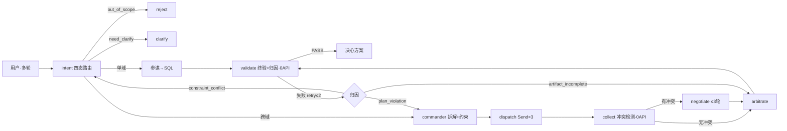

# 联合作战指挥多 Agent 系统 · 项目设计文档（最终版）

| 项 | 内容 |
|---|---|
| 版本 | **v3.0 最终版**（合并前四份文档，单点定稿） |
| 日期 | 2026-09-18 |
| 状态 | 设计 100% · 控制流实测通过（Mock，T1–T12 + 规则引擎 14 项）· 产品实现未开始 |
| 配套 | 详细论证：《设计总纲》《LangGraph 执行层设计》《节点实现规范与规则定义》· 可执行：`langgraph_skeleton_test.py`、`rules_convergence.py` · 图：《节点状态图 v2》《端到端流程图》 |

> 一句话定义：一个**联合作战筹划垂直 agent**——把自然语言作战问题可靠地转成**有全局约束、数字可追溯、冲突可仲裁**的结构化决策支持。核心玩法是"总指挥 + 三军参谋"角色分工，不是一个大模型包打天下。

---

## 1. 业务定义与边界

### 1.1 边界表（进 / 拒 / 转人工）

| 输入类别 | `route` | 处理 |
|---|---|---|
| 单域事实查询（"陆军多少人"） | `single_domain` | 快通道：该域参谋查 SQL 直接作答 |
| 跨域筹划（"登陆作战联合规划"） | `full_chain` | 全链路：指挥拆解 → 三参谋并行 → 冲突检测 →（协商）→ 仲裁 |
| 域内推演/对比（"运力减半怎么调"） | `full_chain` | 全链路 + **版本化增量重规划** |
| **约束矛盾/需求不清** | `need_clarify` | 转人工澄清（`NEED_USER_CLARIFICATION` + 具体问题） |
| **领域外通用任务**（写周报、翻译） | `out_of_scope` | 明示拒答，不顺手代答 |
| **实战指挥 / 真实情报** | `out_of_scope` | 拒答并声明：仅筹划层面、仅模拟数据 |
| **高阶审批**（禁区、超权限调动） | — | `interrupt()` 挂起，人审后 `Command(resume)` |

### 1.2 四角色

| 角色 | 职责 | 产出 |
|---|---|---|
| 入口路由 Agent | 意图识别 → **结构化任务单** → 四态路由 | 任务单 |
| 联合指挥 Agent | 拆解、依赖排序、**下发全局约束**、失败恢复重下发 | 简报 + 约束包 |
| 海/陆/空参谋 ×3 | 域内规划 + 兵力装备查询入口（无状态、可并行、可重试） | `plans/{domain}.v{n}.json` + ≤200 字摘要 |
| 联合仲裁（指挥层职能） | 冲突裁决、折中重规划、一致性校验 | 联合作战决心方案 |

**任务单字段**：`domain`(陆/海/空/联合) · `task_type`(查询/规划/推演/对比) · `complexity`(单域/跨域) · `constraints`(时间窗/兵力上限/禁区/优先级/ROE) · `resolved_refs`(指代消解) · `route`(四态)。路由**读字段**判定，不由模型"感觉"。

**明确不做**：实战指挥 · 真实情报 · 领域外任务 · 通用助手 · **RAG 向量化**（参谋只走结构化查询）。

---

## 2. 总体架构



### 2.1 设计决策链

| 决策 | 结论 | 核心理由 | 被否决方案 |
|---|---|---|---|
| 垂直度 | 领域收窄 + 内部多 agent（两维正交） | 垂直讲领域宽度，非 agent 数量 | 单 agent + 提示词 |
| 执行框架 | LangGraph | `Send`/`interrupt`/`checkpointer` 现成轮子 | 手写 harness |
| 参谋调用 | 隔离 spawn + **简报自包含** | 可并行、可重试、崩溃干净 | 群聊单会话（上下文爆炸、群体谄媚） |
| 协商 | **默认裁决，冲突才升级协商** | 军事上"平时各拟案，争资源才开联席会" | 全程多轮协商（成本高、易震荡） |
| 终止判定 | **规则引擎判**，LLM 无权自行终止 | 成本与可控性双保险 | LLM 自判 done |
| 失败恢复 | **分层回退 + 归因分派** | 回退层由失败归属决定 | 一律 assert 崩 / 一律回 intent |
| 模型档位 | 主力 + 轻量双档 | 辅助调用走轻量，省约 80% 辅助成本 | 单一主力 |
| 数字来源 | **必须来自 SQL** | "陆军多少人"不翻车的唯一办法 | LLM 心算 / 摘要取数 |
| 知识检索 | 结构化查询，**放弃 RAG** | 兵力数据强结构化，向量化不可控 | 向量库语义召回 |

### 2.2 约束纪律
约束（时间窗/兵力上限/禁区/优先级/ROE）**只能由 commander 下发**，参谋**只能在约束内求解、不得改条件**；参谋产物先过规则引擎硬校验，越界即打回（s03 权限闸门）。

---

## 3. 数据设计

**兵力池**：`seed/{army,navy,airforce}.json`（权威种子，"相当于 3 个 Excel"）→ 一次性导入 `db/joint_ops.db`（`units` + `equipment` + `aggregate` 视图）。粒度**单位级**：营/旅、舰艇、中队 + 装备型号数量 + 驻地。

```json
{ "id":"A-001","单位":"第X合成旅","军种":"陆军","人员":4200,
  "主要装备":[{"型号":"99A","数量":56}],"驻地":"XX","战备状态":"一级" }
```

| 存储 | 内容 | 形态 |
|---|---|---|
| 兵力池 ×3 | 单位级编成 + 装备 + 驻地 | SQLite，参谋经查询工具读，可 MCP 化 |
| 会话状态 | 多轮槽位、已下发约束、方案版本 | `checkpoints`（`SqliteSaver`），**外置共享层** |
| 协商黑板 | `round/speaker/claim/objection/resource_ask/concession` | 表 `negotiation_round`，只增 |
| 任务图 | `{task_id:{blockedBy,owner,status}}` | 表 `tasks` |
| 记忆 | 用户偏好/领域约束/项目事实/资源位置 | 表 `memory` |
| 参谋产物 | `plans/{domain}.v{n}.json` | 文件系统（版本化） |
| 过程留痕 | 每次参谋调用与失败 | `trace/*.log` |

**三条硬原则**：① 数字只来自 SQL（JSON 只是种子）；② 产物以落盘文件为准，摘要只是索引；③ **字段结构设计优先于介质选型**（维度太粗会让参谋陷入"信息不足、约束不清"）。

---

## 4. 执行层

### 4.1 State 互通（四通道）

| # | 通道 | 机制 | 互通范围 |
|---|---|---|---|
| ① | 主图节点 | 共享同一份 `JointOpsState`，节点返回**增量 patch** 自动 merge | 全部主图字段 |
| ② | 主图→子图 | `Send` **入参拷贝** + 返回经 **reducer 归并** | 入参 `domain+brief`；出参 1 条 `staff_reports` |
| ③ | 子图内部 | 独立 State + 独立 checkpointer | 仅子图可见；**参谋之间互不可见**（s06） |
| ④ | 大对象/跨轮 | 文件系统 + `checkpointer(thread_id)` | **State 只存路径不存正文**；跨轮恢复槽位/约束/版本 |

**reducer 语义**：普通字段后写覆盖；`Annotated[list, add]` 追加只增不减；**未声明字段被静默丢弃**。
**三个实测坑**：add 只增 → 恢复重跑累积重复报告（须 `latest_by_domain`）；节点同时挂分发边与出边 → 无限自旋（须独立 `dispatch`）；字段未声明 → 输出 `null`。

### 4.2 四个循环

| # | 循环 | 触发 | 退出 |
|---|---|---|---|
| ① | 协商回环 | 共享资源冲突 | 无新 objection / 轮次 ≤3 / 震荡 → 强制裁决 |
| ② | 参谋自纠 | 子图内硬规则失败 | 通过 或 `max_turns=30`（返回 `MAX_TURNS`） |
| ③ | 分层回退 | `validate` 失败并归因 | 恢复成功 或 `retry_count>2` 降级输出 |
| ④ | 多轮会话 | 下一轮输入（同一 `thread_id`） | checkpointer 恢复槽位 + 方案版本 |

> 多轮存的是**"槽位 + 方案版本"**，不是聊天记录：改一个约束 → 只让受影响参谋重算（增量重规划）。

### 4.3 节点与 API 档位

| 节点 | 职责 | API | 失败处理 |
|---|---|---|---|
| `intent` | 意图分类→任务单→四态路由 | 🟡 轻量 | 置信度低 → `need_clarify` |
| `reject`/`clarify` | 拒答 / 人工澄清出口 | 0 | — |
| `commander` | 拆解 + 约束下发 + 恢复重下发 | 🔴 主力 | 约束矛盾 → 置 `infeasible` 供归因 |
| `dispatch` | 参与者裁剪 + `Send` 并行 | 0 | 参谋失败交 `collect` 降级 |
| `staff`×3（子图） | 查库→拟案→硬规则自纠→落盘→摘要 | 🟡+🔴 | 返回 `error_code` 条目 |
| `collect` | 取最新版本·冲突检测·快通道旁路·降级 | **0** | 单参谋失败 → 其余继续 + 标注信息缺口 |
| `negotiate` | 仅拉冲突方增量修订 | 🔴 主力（热点） | 修订后立即跑硬规则 |
| `check_convergence` | CV-1~CV-5 短路判定 | **0** | — |
| `arbitrate` | 硬规则过滤 + 软冲突折中 | 🔴 主力 | — |
| `validate` | 硬规则 + 完整性闸门 + **失败归因** | **0** | → 分层回退 |
| `compose/respond` | 合成 + 让步记录 + 输出 | 0 | — |
| `extract_memory/checkpoint` | 记忆提取 / 持久化 | 🟡 / 0 | — |

> **判定环节永远 0 API**：`collect`（冲突检测）、`check_convergence`、`validate`。LLM 只负责生成与折中。

### 4.4 分层回退（归因决定回退层）

| 失败类型 | 判据 | 回退层 | 理由 |
|---|---|---|---|
| **方案求解失败** | 超兵力上限/违规/触禁区 | `commander` 重下发 | 重解析意图不会让运力变大 |
| **产物格式残缺** | 缺章节 / 数字无源 | `arbitrate` 局部修复 | 与意图约束无关，**不重跑参谋** |
| **约束自相矛盾** | `min_days > deadline` 或需求 > 上限 | `intent` + **升级人工澄清** | 指挥层无解；硬重试会漂移且不可追溯 |

每层 `retry ≤ 2` 封顶 → `FAILED_VALIDATION_DEGRADED` 结构化输出（不崩溃）；单参谋失败 → `APPROVED_DEGRADED` + 标注信息缺口。
**约束不可满足的机器判据**：`min_days = ceil(人数 / (运力 × 800 × 2))`，`min_days > deadline` 即矛盾（实测：8 万人 / 10 架次 = 5 天 > 3 天 → 判定矛盾）。

### 4.5 硬规则（同一引擎，三处调用：参谋自纠 / 协商每轮后 / 终验）

| ID | 规则 | 判据 |
|---|---|---|
| HR-01 | 兵力上限 | `Σ投入兵力 ≤ force_cap` |
| HR-02 | 共享资源申索 | `asks[r] ≤ resource_cap[r]` |
| HR-03 | 时间窗 | `max(timeline.end) ≤ deadline` |
| HR-04 | 禁区 | `areas ∩ no_go_zones = ∅` |
| HR-05 | 交战规则 | `fire_level ∈ roe_allowed` |
| **HR-06** | **编成真实存在（防幻觉单位）** | 每个 `unit_id` 必须在兵力池 |
| **HR-07** | **数字可溯源（防心算）** | 每个数字须带 `source: sql:<query_id>` |
| HR-08 | 产物完整性 | 必填章节齐备（`时序表/风险/资源来源`） |

### 4.6 收敛判据（0 API，短路判定）

| ID | 判据 | 结果 |
|---|---|---|
| CV-1 | 无资源冲突 | ✅ 收敛 |
| CV-2 | `round ≥ 3` | ⛔ 强制裁决 |
| CV-3 | 总申索降幅 `< 2%`（停滞） | ⛔ 停止 |
| CV-4 | 本轮无新增 objection | ✅ 收敛 |
| CV-5 | 任一方申索**不降反增**（让步被收回） | ⛔ 强制裁决 |

**顺序**：`CV-2 > CV-5 > CV-1 > CV-4 > CV-3 > continue`。**震荡优先于无冲突**——否则参谋会学会反复横跳。
**收敛 ≠ 一致同意**（收敛后仍进仲裁做最后折中）；**封顶不是失败**（产出带残余风险的裁决 + 完整让步记录）。

### 4.7 API 调用点与成本

| 档位 | 调用点（编号沿用执行层设计） | 次数 |
|---|---|---|
| 🔴 主力 | 指挥拆解 API-2 · 参谋拟案 API-4 · 协商修订 API-5 · 仲裁 API-6 · 压缩 API-7 | 主力成本集中在 API-5 |
| 🟡 轻量 | 意图分类 API-1 · 查库改写 API-3 · 摘要 API-12 · 记忆×3 (API-8/9/10) · 权限分类 API-11 | 每轮固定，极低成本 |
| 非 LLM | MCP 工具调用 API-13 | 按需；API-14 prompt cache 强烈建议开启 |

**成本闸门**（协商是唯一 🔴🔴 热点）：轮次 ≤3 · 参与者裁剪（只拉冲突方，通常 2 个）· 震荡即退。
**最坏 ≈ 24 次主力调用；最好（单域查询）≈ 4 次。**

**韧性（写一次处处生效）**：429 → `min(500×2^n, 32000) + 25% 抖动`（≤10 次）；529 → 连续 3 次切 fallback；`max_tokens` → 8K→64K 升级（≤3 次）；413 → reactive compact 重试 1 次；MCP 断连 → 退避重连；参谋超限 → `MAX_TURNS` + 落盘路径。

---

## 5. 关键契约（写代码前固化）

| # | 契约 | 要点 |
|---|---|---|
| C1 | 简报自包含 | 任务单+约束+资源快照+输出 schema+落盘路径，全部随 `Send` 拷入 |
| C2 | 产物落盘为准 | 完整 JSON（主）+ ≤200 字摘要（辅） |
| C3 | 数字只信文件 | 指挥与仲裁不采信摘要中任何数字 |
| C4 | 状态外置 | 槽位/约束/版本存共享层，不寄望子 agent 记忆 |
| C5 | 失败结构化 | 失败也返回 `error_code` + 落盘路径 |
| C6 | 过程留痕 | 子 agent 自写 `trace/*.log` |
| C7 | 防震荡 | 每轮版本 diff，让步被收回即强制裁决 |

---

## 6. 范围与分期

**v1 范围 = 完整版**：最小闭环 + 协商循环 + MCP + 完整多轮增量重规划。

```
joint-ops/
├─ config/    constraints.yaml（force_cap/deadline/no_go/ROE/resource_cap）+ limits(rounds=3,retry=2,max_turns=30)
├─ seed/      army.json · navy.json · airforce.json
├─ db/        joint_ops.db：units·equipment·checkpoints·negotiation_round·tasks·memory
├─ src/graph/ state.py · nodes/ · edges.py（四态路由 + 分层回退）
├─ src/staff/ 参谋子图（domain 参数化）
├─ src/tools/ 兵力池 SQL · 落盘 · MCP 桥
├─ src/rules/ 硬规则 · 冲突检测 · 收敛判据 · 失败归因（0 API）
├─ src/llm/   双档客户端 + with_retry
├─ plans/     {domain}.v{n}.json      └─ trace/  *.log      └─ tests/  T1–T12
```

| 阶段 | 内容 | 课程 | 状态 |
|---|---|---|---|
| M1 循环内核 | 单 agent + 兵力池查询（数字来自 SQL） | s01+s02 | 🟡 结构验证（Mock） |
| M2 安全层 | 硬规则 + 越权拦截 | s03+s04 | ⚪ |
| M3 隔离并行 | 参谋子图 + `Send` | s06+s13 | 🟡 结构验证 |
| M4 任务图 | 拆解 + 依赖解锁 | s12 | ⚪ |
| M5 冲突仲裁 | 规则引擎 + 中心裁决 | — | 🟡 结构验证 |
| M6 协商子循环 | 黑板落盘 + 收敛 + 防震荡 | s15+s16 | 🟡 部分（黑板未落盘） |
| M7 记忆与压缩 | checkpointer + 增量重规划 | s08+s09 | ⚪ |
| M8 韧性 | 重试 + 降级 | s11 | 🟡 部分（节点级已验证） |
| M9 外部能力 | MCP 气象/地图 | s19 | ⚪ |
| M10 集成 | 一个循环装下所有机制 | s20 | ⚪ |

**风险**：范围大 × 验收标准低 → 最大风险是**中途失控**。对策：按 M1→M10 **分期累积验收**，每期独立跑通判据，禁止最后一锤子买卖。s01–s20 覆盖 **20/20**（18 直接映射，2 项暂缓：s14 cron、s18 worktree）。

---

## 7. 验收标准

**总标准**：三类典型链路跑通且行为符合设计。**红线**：① 领域外请求被接；② 数字非 SQL 来源；③ 失败导致整次会话崩溃。

| 用例 | 期望 | 实测 |
|---|---|---|
| "帮我写周报" | `REJECTED_OUT_OF_SCOPE`，0 参谋 | ✅ |
| "陆军多少人" | `APPROVED_QUICK_PATH`，仅 1 份报告，跳过指挥与仲裁 | ✅ |
| 复杂登陆背景 | 3 报告 → 冲突 → 协商 ≤3 轮 → 仲裁 → PASS | ✅ |
| 校验故障（超限） | 归因 `plan_violation` → 回 commander → 恢复 | ✅ T7 |
| 残缺方案 | 归因 `artifact_incomplete` → 回 arbitrate，参谋不重跑 | ✅ T8 |
| 必败故障 | 2 次后 `FAILED_VALIDATION_DEGRADED`，不崩溃 | ✅ T9 |
| 海军失联 | `APPROVED_DEGRADED` + 信息缺口标注 | ✅ T10 |
| 约束矛盾 | 归因 `constraint_conflict` → 回 intent 转人工澄清 | ✅ T11 |
| 三层回退覆盖 | intent / commander / arbitrate 均被走到 | ✅ T12 |

**已验证资产**：`langgraph_skeleton_test.py`（八用例 T1–T12 全 PASS，Mock 模型，故障经 `fault` 字段注入；双档计数**主力 124 / 轻量 36**，含恢复重跑；单条正常全链路 ≈ 主力 14 次）；`rules_convergence.py`（规则引擎 14 项自测全 PASS）。**未验证**：语义层（真 LLM 方案质量）、数据层（真实 SQLite 兵力池）、真收敛（实测为 3 轮封顶，非自然收敛）。

---

## 附录 A：文档关系

| 文档 | 回答什么 |
|---|---|
| **本文** | 是什么、范围多大、怎么建、怎么验收（单点定稿） |
| 《设计总纲》 | 领域细节：角色、协商/仲裁机制、术语 |
| 《LangGraph 执行层设计》 | 运行时：State/节点/边、API-1~14、s20 闭环对照 |
| 《节点实现规范与规则定义》 | 逐节点输入/输出/失败、prompt 骨架、HR 与 CV 细则 |

## 附录 B：决策记录（14 项已关闭）

交付形态=可运行骨架 · 单域=快通道直连 · 仲裁=硬规则+模型折中+冲突触发协商 · 兵力池=单位级 · 框架=LangGraph · 模型=主力+轻量双档 · 检索=放弃 RAG · 服务对象=方法论+工程规格双职能 · 成功标准=三类链路跑通 · v1=完整版 · 失败恢复=分层回退+归因分派 · **模型路线=先接线上模型调试、通过后本地部署** · **本轮范围=第一期最小可用（兵力池+线上模型+最小闭环），协商/多轮/MCP 顺延** · **工程顺序=先底层框架（图/状态/规则/数据/模型）跑通，前端页面框架放最后一期**。

**分期（与《联合作战指挥多Agent设计项目书简易版》口径一致）**：一期兵力池+线上模型最小闭环 → 二期协商落盘+硬规则 → 三期多轮+增量重规划 → 四期本地部署+集成韧性 → 五期 MCP+前端页面。

**仍待办（实现/编写任务，非架构悬案）**：① 通信契约正式文本（prompt 骨架已就位）；② 协商黑板表 DDL（收敛判据已定稿）；③ 边界表具体词表（本体实体与同义词收敛）。

## 附录 C：术语

快通道（单域直连该域参谋，跳过指挥与仲裁）· 全链路（跨域完整链路）· 简报（自包含派遣指令）· 黑板（协商记录表，参谋唯一横向通道）· 收敛判据 · 震荡（让步被收回）· 分层回退 · 降级（标注缺口仍可用）· `out_of_scope` · 任务式命令（只给意图/约束/资源/回报格式）。
